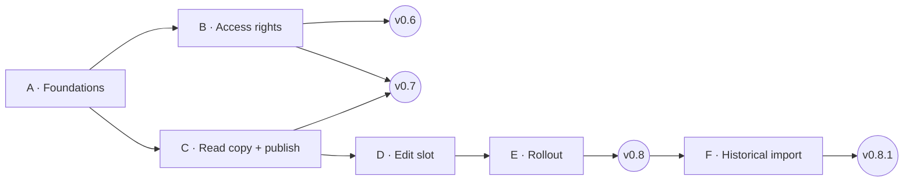

# EPL Tool — Development plan: access rights + multi-user

*Status: decisions recorded · Phases A + B done · v0.6 released as v0.6.1 · Phase C released as v0.7.0 on 9 Nov 2026 (two-PC
test with a colleague running on the release) · Phase D (edit slot) built on `main` 10 Nov 2026 (two-PC test pending), Phase
E next · updated 10 Nov 2026 · current version v0.7.0*
*Studies: [access-rights-study.md](./access-rights-study.md) · [multi-user-study.md](./multi-user-study.md) · AI features:
`docs/local/ai-study.md` (local only, not in git — see CLAUDE.md → Known issues / open items)*

---

## 1. Overview

The work is split into **6 phases** and delivered in **4 releases**. Each release can be used on its own, so colleagues can be
brought in step by step.

| Release | Phases | What you get | Who can be onboarded | Effort |
|---|---|---|---|---|
| **v0.6 — Governance** | A Foundations + B Access rights | User list, roles, customer pricing modes, *New Customer*, activity log, rules checked in the background process, Help section | Still only you. You set up users, modes and managers and test them with *Preview as…* | 7–8.5 d |
| **v0.7 — Shared reading** | C Read copy + publish | Everybody works on a fresh local copy. An admin edits through *Start editing* / auto-publish, protected by the generation check | **Viewers**, and Users in read-only mode | 3–4 d |
| **v0.8 — Shared editing** | D Edit slot + E Rollout | Edit slot with waiting, take-over, crash recovery and price-list rescue. Update notice, onboarding kit | **Everybody**, within their rights | 4.5–6 d |
| **v0.8.1 — Historical import** | F Import wizard | Upload historical price lists for existing customers and products, from a clear Excel template | — | 2–3 d |
| | | | **Total** | **≈ 16.5–21.5 d** |

**B and C both depend only on A**, so they can be built in parallel. Releasing B first is recommended: access rights must be in
place before anybody else opens the tool.

**Decisions this plan builds on** (details in the two studies):

- **Identity:** Windows account + company email, no password.
- **Roles:** Admin / User / Viewer; unknown users are blocked and can request access.
- **Customers:**
  - one or several managers per customer; managers + admins change master data
  - anyone (Admin/User) can create a customer and becomes its manager
  - existing customers start as *Managed by PBP*; the old "Managed by" text field is dropped
- **Activity log:** visible to everybody.
- **Email templates:** per user.
- **FX rates:** admins set the shared defaults; anybody can use their own rates for the current session.
- **SharePoint permissions:** managed outside the app; the app only reminds admins.
- **Multi-user:** auto-publish about a minute after the last change; take-over after 15 min, release after 30 min; no IT / no Graph
  API; Windows only.
- **Go-live:** the central database may be moved or renamed.

---

## 2. Already done (5 Nov 2026)

- **The old Excel import was removed**:
  - `ipc/migration.ts`, `ImportScreen.tsx`, the `migration:*` channels and their types
  - the Settings card
  - the SheetJS (`xlsx`) dependency and its packaging special case (`forge.config.ts`, `vite.main.config.ts`)

  Checked: type check (only the existing, known errors), lint, Vite build, and packaging into a temporary folder.
- **"Admin Email Addresses" was renamed to "PBP Emails"**: on the Settings card, and as the "PBP" badge/filter and hints on the
  Emails tab and customer page. The `admin_emails` table keeps its name.
- **README and CLAUDE.md** were updated accordingly.

---

## 3. In-app Help (built up across releases)

A **Guides & Help** entry in the sidebar (all roles; above *Change Database*, renamed from "Help" on 6 Nov 2026 so it reads
as documentation and guides), plus "?" links from the relevant controls (Pricing management card, *Start editing*
dialog, FX popover, import wizard). It is written for users; the files in `docs/` stay the design notes.

**How it's built**

- Topics are Markdown files in `src/renderer/help/` and are bundled into the app, so Help works offline and always matches the
  installed version. A small Markdown renderer and a search box over the topics.
- **No duplicated facts:**
  - The permission matrix is **generated from `shared/permissions.ts`**.
  - Timeouts and delays (15 min take-over, 30 min idle release, ~60 s auto-publish, ~45 s slot reservation, 30 s refresh) are
    inserted from the **same constants the code uses**.
  - So Help can't contradict the app.
- **Your access** block at the top: your name, role, the customers you manage, and the admins to contact (with a *Request a
  change* email button).

**Topics by release**

| Release | Topics |
|---|---|
| v0.6 | Getting started & your access · Roles & permissions · Pricing management modes · Creating price lists (single / mass) · Customers & New Customer · Emails tab & PBP emails · Analysis & FX rates (session vs default) · Activity log · Backups · *What's new* |
| v0.7 | Shared database: read mode, *data of …* status, refresh, offline copy, "newer data still syncing", updating the app, editing for admins and conflicts — **written 9 Nov 2026** (topic *Shared database*) |
| v0.8 | Editing: *Start editing*, waiting for the slot, auto-publish, **timeouts**, take-over, crash recovery, conflicts and *Re-apply my price lists* — **written 10 Nov 2026** (topics *Editing the shared database* and *Conflict copies*; *Shared database* rewritten for v0.8) · **written 12 Nov 2026 (Phase E):** *Installing EPL Tool & first start* · *Rules of use* (own topic) · *Onboarding a new user* (admins, incl. SharePoint permissions, publishing a setup and going live) · *FAQ & troubleshooting* (OneDrive, SmartScreen, notifications, Outlook, updates) · the card, *Force release* and *Updates* in *Shared database* |
| v0.8.1 | Historical import: template, validation messages, what is never created |

**Effort:** 0.5 d to build the Help screen, then about 0.25 d of writing per release (included in the phase estimates).

---

## 4. Phases

### Phase A — Foundations (1.5–2 d) — **done 6 Nov 2026**

- [x] **Identity**
  - [x] Add `main/auth.ts`: Windows account from `os.userInfo()`, email from `whoami /upn`, with the OneDrive account email from
        the registry as fallback.
  - [x] Add an `auth:whoami` channel. A development-only environment variable can pretend to be another user
        (`EPL_DEV_ACCOUNT` / `EPL_DEV_EMAIL`, ignored in packaged builds).
- [x] **Schema numbering:** use `PRAGMA user_version` as the schema version (existing level = 6); turn `migrateIfNeeded` into
      numbered steps. A database with a newer schema than the app is refused with *"please update EPL Tool"* (decided 6 Nov;
      Phase C turns this into read-only).
- [x] **Make the database shareable** (multi-user study §5.9):
  - [x] Stop writing `db_path` into the database.
  - [x] Store the logo **inside the database**; export uses ExcelJS `addImage({ base64 })`. Decided 6 Nov: **no fallback to
        the old file path** — an admin selects the logo once in Settings (admin-only from Phase B).
  - [x] Save **email templates per user** in the local `settings.json` (new `prefs:get` / `prefs:set` channels). Decided 6 Nov:
        the old template stored in the database is ignored; the built-in default is used until a user's first send.
  - [x] Also: opening an existing database no longer changes the file (the `units` / `currencies` seeds rewrote
        `sqlite_sequence` on every open), and the generic `settings:get` / `settings:set` channels were removed.
- [x] **Customer update:** `customers:update` accepts only an allow-list of fields.
- [x] **Release menu:** decided 6 Nov: **no menu bar** in releases on Windows (macOS keeps only the app/Edit/Window menus);
      Developer Tools only in development (admin exception added in B).
- [x] ~~Excel import fix~~ — not needed: the old import was removed (§2).

**Done when:**

- [x] an existing database opens with no data change
- [x] sending an email doesn't change the database file (date unchanged)
- [x] the logo appears in exports made from a copy of the database on another PC

Checked on copies of the databases, by running the real main-process code outside the app (no app launch).

### Phase B — Access rights + Help (5.5–6.5 d) → release v0.6 — **done, released as v0.6.1 on 6 Nov 2026**

- [x] **Database:** Migration 7.
  - [x] Add `users`, `customers.pricing_mode` (all → `pbp`), `customer_managers`, `price_lists.created_by_user_id` and
        `audit_log`.
  - [x] Drop `customers.price_list_managed_by` and remove it from types, the customer page and `customers:create`.
  - [x] Make the current Windows user the first admin.
- [x] **`shared/permissions.ts`:** the permission functions used by both sides, plus unit tests (`node:test` via `tsx`, the first
      automated tests in the repo; add `npm test`).
- [x] **A check on every action:** one helper for all channels.
  - [x] Each channel declares its rule; anything not declared is refused.
  - [x] Users who are not on the list can only use `db:*` / `auth:*`.
  - [x] Clear refusal messages.
- [x] **Per-customer checks** in:
  - [x] `price-lists:create` / `price-lists:delete`
  - [x] `customers:update`, hide / restore / permanent delete
  - [x] `emails:set-assignments` / `emails:replace` / `emails:remove` (change only allowed customers, report the skipped ones)
  - [x] new `customers:create` (the creator becomes manager)
  - [x] new `customers:set-access`
- [x] **Activity log:** an `audit()` helper called in the same transaction as every change; `audit:list` with filters.
- [x] **FX rates:**
  - [x] `fx:set` becomes admin-only and saves the **default** rates.
  - [x] The Analysis screen keeps **session rates** in memory only (forgotten when the app closes — decided): start from the
        defaults, *"Your rates (this session)"* label, *Reset to defaults*, and *Save as default rates* for admins.
- [x] **PBP Emails:** admins can add, edit and remove entries. The old import was the only way to fill a new database.
- [x] **Screens:**
  - [x] **Basics:** `AuthContext`, `useCan()`, `LockBadge`, and a route guard that sends unknown users to `/no-access`.
  - [x] **No-access screen:** admin contacts, a *Request access* email, and a short help text.
  - [x] **Sidebar:** name and role.
  - [x] **Settings → Users:**
    - [x] add, edit role, deactivate
    - [x] the last admin can't be removed
    - [x] warning about customers left without an active manager
    - [x] **SharePoint reminder** (Edit for Admin/User, Read for Viewer) and an *Open shared folder* button
    - [x] **Preview as…**
  - [x] **Customers:**
    - [x] Customers list: mode badges and a *My customers* filter.
    - [x] Customer detail: **Pricing management** card (mode + managers) and a **History** section.
    - [x] **New Customer** dialog: SAP ref (required, unique), names, currency, packaging, region, etc.; the creator becomes
          manager; admins choose the mode.
  - [x] **Wizards:**
    - [x] Single wizard Step 1: lists only the user's own customers.
    - [x] Mass update Step 1: other customers are locked, with the reason.
  - [x] **Emails tab:**
    - [x] Edit dialog: only allowed customers can be ticked.
    - [x] Replace / Remove: change only allowed customers, with an *"x of y"* message.
  - [x] **Price lists:**
    - [x] Delete only where allowed.
    - [x] *"Created by"* shown on the price list page.
  - [x] **Read-only for non-admins:** Products, Standard EPL (export stays available), Packaging, Currencies, Units, PBP Emails,
        logo and backup actions.
  - [x] **Settings → Activity:** visible to all, with filters and export to Excel.
- [x] **Help v1** (§3): the screen and the v0.6 topics.
- [x] **Developer Tools:** allowed for admins only in releases.
- [x] **Docs:** README and CLAUDE.md.

**Done when:**

- [x] the permission unit tests pass — `npm test`: 49 tests (every role × mode × action, and the generated matrix against §3.2)
- [x] every row of the permission matrix (access-rights study §3.2) has been checked manually with *Preview as…* for User and
      Viewer — done in the app on 6 Nov 2026 ("all is working well")
- [x] calling a forbidden channel through Developer Tools is refused — every channel goes through the guard; checked by
      calling the real handlers as Admin, User, Viewer, unknown and deactivated people on copies of the database
- [x] every change appears in the activity log
- [x] the matrix shown in Help matches the enforced rules — it is generated from `shared/permissions.ts`

**Implementation notes (6 Nov 2026):**

- Guard: `main/ipc/guard.ts` — every channel is registered with `handle(channel, rule, fn)`, rule `public` / `viewer` /
  `editor` / `admin`; `ipcMain.handle` itself is disabled, so a channel can't exist without a rule. Public channels: `db:*`,
  `auth:*` and the backup recovery channels (`backup:list`, `backup:open-folder`, `backup:restore`).
- Restore from the damaged-database screen is allowed when the current Windows identity is an active admin **in the
  backup** (backups older than the user list are allowed) — decided 6 Nov.
- New customers get PBP copy / PBP common from Settings → PBP Emails (decided 6 Nov). Managers may be active Users or
  Admins (decided 6 Nov).
- Removed unused channels (decided 6 Nov): `customers:delete`, `packaging:update-price`, `export:open-mail-with-attachment`;
  `fx:set` became `fx:set-defaults` (admins, one audited call).
- Checked outside the app on copies of both database files: 105 checks for Phase B (Migration 7, bootstrap, guard, rules,
  preview, emails, audit, restore) and the 52 Phase A checks.
- An independent code review found two issues, both fixed: `price-lists:create` now inserts only the line fields (a crafted
  entry could carry another list's id), and lists of customers that no longer exist (orphans) can be deleted by admins.

### Phase C — Read copy + publish (3–4 d) → release v0.7 — **released as v0.7.0 on 9 Nov 2026**

**Kickoff decisions (confirmed by the user on 9 Nov 2026 — all proposals accepted; the cache goes to `%LOCALAPPDATA%`).**
The design itself is in the multi-user study §5, decisions in §8.

1. **Local mode — kept.** *Open a local database (no sharing)* stays on the setup screen next to *Connect to shared database*
   (test databases, development). Safeguard: local mode refuses a file that has a `<name>.manifest.json` next to it, so the
   shared database can't be opened directly by mistake.
2. **Existing installs — offer if synced.** On the first start of v0.7, if `lastDbPath` is in a OneDrive/SharePoint-synced
   folder, the setup screen offers to connect to it as the shared database; otherwise it keeps opening as a local database.
3. **Writes while reading — skipped.** In read mode account linking is skipped (the person is recognised by email; the account
   is recorded at the next *Start editing*). The first-admin bootstrap runs only in local mode or in edit mode. Migrations run
   on the local copies only.
4. **Guard — `writes` flag.** `editor`/`admin` channels carry a `writes` flag in `ipc/guard.ts`; in read mode they are refused
   with *"Read-only — click Start editing"* before the handler runs. `query_only` stays as the safety net. Order: role →
   read-only → per-customer rule (inside the handler).
5. **Backups.** Shared database: one backup to `EPL-Backups/` at *Start editing* and before a restore; the local cache gets no
   backups. Local mode keeps today's backup on open.
6. **Activity log — one `sync.publish` entry per publish** (who, when, generation).
7. **Who edits in v0.7 — Admins only.** Users stay read-only until the edit slot (v0.8). Today only the PBP admin uses the tool.
8. **Auto-refresh — when idle.** Changes are checked every ~30 s and applied automatically when no wizard, dialog or unsaved
   edit is open; otherwise a *New data — Refresh* banner is shown.
9. **Paths.** Local copies in `%LOCALAPPDATA%\epl-tool\cache\` and `work\` (not roamed with the Windows profile);
   `settings.json` stays in `%APPDATA%\epl-tool`. Manifest `<db name>.manifest.json` and `EPL-Conflicts/` next to the central DB.
10. **Tests.** Now: `scripts/main-checks/phase-c.checks.ts` simulating two PCs (separate `userData` / local folders, a shared
    temp "central" folder). Before the release: a two-PC test with a colleague on a separate SharePoint **test** folder holding
    a copy of the database (not the real central database).

**Starting points in the code:** `main/database.ts` (`openDatabase`, startup backup, `bootstrapFirstAdmin`),
`main/localSettings.ts` (`lastDbPath`), `main/currentUser.ts` (account linking), `main/ipc/guard.ts`, `main/ipc/settings.ts`
(`db:open` / `db:create`), `main/ipc/backup.ts`, `renderer/screens/DatabaseSelector.tsx`, `renderer/components/layout/Sidebar.tsx`
(status line), `renderer/App.tsx` (`AccessGuard`).

**Technical design (approved by the user on 9 Nov 2026, including the early warning, read mode after a refused publish, the
unpublished-changes recovery and re-rendering instead of reloading)**

*Main process — new folder `main/sync/`:*

- `centralStore.ts` — the `CentralStore` interface and its `SyncedFolderStore` implementation (the only code that touches the
  shared folder, always with async file calls so a slow OneDrive download never freezes the window):
  - `probe()` — size and date of the central file + the manifest (cheap; every 30 s)
  - `download(dest)` — copy to a temp file, `quick_check`, read generation / schema / publisher, sha256, then rename
  - `publish(snapshot, expected)` — generation check, copy to `<name>.db.tmp` in the central folder, `quick_check`, rename
    over the central file (retried while OneDrive holds it), then the manifest (`.tmp` + rename)
  - `saveConflictCopy(file)` → `EPL-Conflicts/<name>_<date-time>_<account>.db`
  - `findConflictCopies()` — OneDrive conflict copies of the central file (`<name>-<PC>.db`, `<name>-<PC>-2.db`, …)
  - `canWrite()` — writes and deletes a `.tmp` probe file (detects *Read* permission on SharePoint)
- `paths.ts` — `%LOCALAPPDATA%\epl-tool\cache\` (`<name>.db` + `cache.json`: central path, sha256 / generation of the source,
  time of the copy) and `work\` (`<name>.db`, `session.json`).
- `oneDrive.ts` — "is this file in a synced folder": OneDrive mount points from the registry
  (`HKCU\Software\SyncEngines\Providers\OneDrive\*\MountPoint`, which lists every synced SharePoint library) + the `OneDrive*`
  environment variables.
- `sync.ts` — the connection (local / shared), the modes (read / offline / edit), the timers and the status pushed to the
  screens. `ipc/sync.ts` — its channels.

*Database:* **Migration 8** adds `sync_meta` (one row: `generation`, `published_by`, `published_by_account`, `published_at`,
`published_app_version`; generation 0 = never published). **Manifest** `<name>.manifest.json`: generation, sha256, size,
published by / at, schema version, app version, `minAppVersion` (a constant in the code, raised when older apps must stop
editing).

*Generation check:* a publish is accepted only if the central file is still **exactly** the one the editor started from or last
published: same sha256 (this also catches a file changed outside the app) and no higher generation in the manifest.

*Read mode (everybody; the default for a shared database):*

- On connect, at start and every 30 s: probe the central file. If it changed → download into the cache folder and verify.
  - Manifest generation higher than the file's → *"Newer data published by Anna is still syncing to your computer"*; keep the
    current copy and retry.
  - Same content as the current copy → nothing to do.
  - Otherwise → applied at once when no wizard or dialog is open; else the banner *"New data published by Anna at 14:05 —
    Refresh"*. Applying = swap the file, reopen, and re-render the current screen (no page reload, so session FX rates stay).
- The copy is opened with migrations on the copy, then `PRAGMA query_only = ON`; no bootstrap, no account linking.
- Central file unreachable → **offline**: the last copy, *"Offline copy of 5 Nov 10:45"*, retried every 30 s.
- A copy that fails `quick_check` → keep the last good copy and retry (message after 3 failed attempts).
- Central schema newer than the app, or `minAppVersion` above the app version → read the copy as it is (no migrations,
  `query_only`), banner *"Published by a newer EPL Tool — update to x.y.z to make changes"*; *Start editing* blocked.

*Edit mode (Admins; anybody when the user list is empty, so the first admin can be created):*

- *Start editing*: checks (online, nothing still syncing, app version, write access to the folder) → fresh copy into `work\`
  → backup of that copy in `EPL-Backups/` → opened read-write (migrations, account linking, bootstrap) → `work\session.json`.
- Every change marks the copy as changed; **auto-publish ~60 s after the last change**, *Publish now*, and *Finish editing* =
  publish + back to read mode (the working copy becomes the read copy).
- Publish: snapshot of the working copy (`VACUUM INTO`) → in the snapshot: generation + 1, publisher, time, app version and the
  `sync.publish` activity entry → generation check → copy + rename → manifest → the same stamp is applied to the working copy.
  Changes wait while a publish runs (about a second), so nothing slips in between.
- **Refused** (someone else published) → the working copy is saved to `EPL-Conflicts/` (kept locally if that fails), the app
  goes back to read mode on the fresh data, with a red banner naming the saved file. The re-apply tool comes in Phase D.
- Other publish errors (OneDrive busy, network) → stay in edit mode, retry at the next change / 30 s check, error shown.
- While editing, the 30 s check also watches the central file: if someone else publishes, a warning appears at once.
- Closing the app while editing: publish first; if that fails, *"Quit anyway — your changes stay on this PC"* / *Cancel*.
- **Unpublished changes found at start** (crash, or quit anyway): banner *"Unpublished changes from 10:41"* [Publish now]
  [Discard] for admins; *Publish now* uses the same generation check. (Small version of Phase D's crash recovery.)

*Guard and rules:*

- `handle()` gets a `writes` flag, on by default for `editor` / `admin` channels (all of them change data today). Order: database
  open → on the user list → role → read-only → handler (per-customer rules).
- Read-only messages live in `shared/permissions.ts`: admins *"Read-only — click Start editing to make changes."*; Users and
  Viewers *"Read-only — only admins can change the shared database in this version."* (Viewers still get the role message
  first); offline *"Offline copy — changes need the shared database."*; newer app needed *"Update EPL Tool to x.y.z to make
  changes."* Any `SQLITE_READONLY` error becomes the same message (safety net).
- New rule `canStartEditing(user)` (Admins) + a matrix row *"Start editing the shared database"* (generated for Help,
  unit-tested).

*Backups and restore:* shared database → one backup at *Start editing* (of the freshly downloaded copy); *Back up now* only
while editing; no backups of the cache; the Backups panel always shows the central folder's `EPL-Backups/`. **Restore** in
shared mode = an editing session started from the backup and published at once (the working copy is kept as the pre-restore
copy). It needs edit mode, except when the central file is damaged: then an admin of the backup can restore from read mode,
as on today's damaged-database screen. Local mode: unchanged.

*Local mode and settings:* `db:open` / `db:create` work as today (backup on open) and refuse a shared database (manifest next to
it). `settings.json` gets `connection: { mode: 'local' | 'shared', path }`; the old `lastDbPath` is read once for decision 2.

*Screens:*

- `SyncProvider` / `useSync()`: status pushed by the main process, actions (start / finish editing, publish now, refresh). Busy =
  a dialog is open (counted by the shared `Dialog`) or a wizard route is shown; updates are applied automatically when not busy.
- `useCan()`: every change permission also requires "writable" (local mode or editing), and `lockReason` returns the read-only
  reason — so all existing locks and hidden buttons follow without per-screen changes. The Users screen keeps the list and
  *Preview as…* in read mode.
- `AppShell`: one banner area (editing / new data / still syncing / offline / update needed / conflict / unpublished changes);
  the current screen is re-mounted after the data was swapped.
- Sidebar: status line under the user — *"Read-only · data of 5 Nov 10:45 (Anna)"*, *"Editing · published 10:47"*, *"Offline
  copy · 5 Nov 10:45"*, *"Local database"* — with *Start editing* / *Finish editing* and *Refresh*. *Change Database* opens the
  setup screen.
- Setup screen `/setup`: **Connect to shared database** (main button) · *Open a local database (no sharing)* · *Create a new
  local database*; the offer for existing installs; the damaged-database restore as today. Settings → Database shows the mode
  and the central path.
- Delays (30 s check, 60 s auto-publish) are constants in `shared/sync.ts`, inserted into Help.

*Checks (`phase-c.checks.ts`):* the check file forks two worker processes, **PC A** and **PC B**, each with its own `userData`,
`%LOCALAPPDATA%` and identity, sharing a temp `central\` folder holding a prepared copy of the sample database. Scenarios:
connect + read mode on both, the central file unchanged by readers (sha256), read-only refusals and the `query_only` safety net,
start editing (one backup), publish (generation, manifest, activity entry), B picks up A's change, two admins editing at once
(second publish refused → `EPL-Conflicts/`, nothing overwritten), "still syncing", offline start from the cache, newer schema,
local mode refusing a shared database, the existing-install offer, unpublished changes after a killed process, restore in
shared mode, OneDrive conflict copies.

*Build order (one commit each, for review):* 1) Migration 8 + `CentralStore` · 2) read mode + guard · 3) edit mode ·
4) setup screen, status line, banners · 5) Help + docs → v0.7.0.

- [x] **SharePoint access in one place:** a `CentralStore` interface and a `SyncedFolderStore` implementation that handles
      (`main/sync/centralStore.ts`, done 9 Nov 2026, checked by `phase-c.checks.ts`):
  - [x] download + verify
  - [x] manifest
  - [x] publishing with the generation check
  - [x] spotting OneDrive conflict copies
- [x] **Generation number:** stored in the database (Migration 8: `sync_meta`).
- [x] **Read mode** (done 9 Nov 2026 — `main/sync/sync.ts`, `ipc/sync.ts`, guard `writes` flag, screens):
  - [x] Open the local copy with `PRAGMA query_only`; in read mode, "read-only" errors become the message *"Read-only — click
        Start editing"* (the role check runs first).
  - [x] Check for changes every 30 s; refresh automatically or show a banner (applied at once when no dialog or wizard is
        open, otherwise *New data — Refresh*; also checked when the window gets the focus).
  - [x] Offline mode using the last copy.
  - [x] Block editing when the database needs a newer app version (`minAppVersion` / schema version).
- [x] **Edit mode, first version (Admins only, no edit slot yet)** — main process done 9 Nov 2026 (`main/sync/sync.ts`):
  - [x] *Start editing* copies the fresh database to a working copy.
  - [x] Auto-publish about 60 s after the last change; *Finish editing*. Also *Publish now*, publish on quit (with *Quit
        anyway* when it fails) and the unpublished-changes recovery at the next start.
  - [x] A publish that conflicts with someone else's is refused, and the copy is saved to `EPL-Conflicts/` (the working copy
        as it was, not stamped); the editor gets a warning as soon as someone else publishes.
- [x] **Backups:** one backup at the start of each editing session; none on every open; read-only users never write to
      SharePoint. Restore in shared mode goes through the working copy and is published at once (also from read mode when
      the shared file is damaged).
- [x] **Setup and status:** a setup screen *"Connect to shared database"* and a status line in the sidebar (done 9 Nov 2026,
      with the banners, read-only locks through `useCan()`, *Preview as…* in read mode, the first-admin path on the
      no-access screen). Checked visually in an isolated development instance (`EPL_DEV_USER_DATA`, temp copy of the sample
      database): first admin, editing, publish, Ben's version picked up, *Refresh* banner during a wizard, offline, early
      warning and refused publish.
- [x] **Help:** the v0.7 topics — new *Shared database* topic (connecting, read mode and the status line, refresh, offline
      copy, still syncing, update needed, editing for admins, conflicts and `EPL-Conflicts/`, rules of use; the 30 s / ~1 min
      delays are filled in from `shared/sync.ts`), plus *Getting started*, *Roles*, *Backups* and *What's new* updated, and a
      "?" link next to the sidebar status line (done 9 Nov 2026).

**Status 9 Nov 2026:** all Phase C items are built and checked outside the app (`npm run test:main`: phase-c 165 checks on
simulated PCs) and visually in an isolated development instance. **Released as v0.7.0 on 9 Nov 2026** at the user's request,
so the two-PC test with a colleague (decision 10, separate SharePoint test folder) runs on the release build; Phase D starts in
parallel.

**Done when** (two PCs: you + a colleague):

- the reader sees the admin's changes within about 1–2 minutes
- the reader never changes the central file
- a publish on top of a newer central version is refused and the work is kept
- offline start works from the last copy

### Phase D — Edit slot (3–4 d) — **steps 1–5 built 10 Nov 2026** (on `main`; two-PC test pending; released with Phase E as v0.8.0)

**Kickoff decisions (confirmed by the user on 9 Nov 2026 — all proposals accepted).** Design in the multi-user study
§5.5–5.7; timeouts decided earlier (§8: take-over after 15 min without heartbeat, release after 30 min without changes).

1. **Who edits from v0.8:** Admins and Users (Users only change what their rights allow); Viewers never.
2. **v0.7 apps:** the minimum editing version becomes **0.8.0** — once v0.8 publishes, v0.7 apps are read-only with *"Update
   EPL Tool to 0.8.0 to make changes"*.
3. **Waiting:** dialog *"Anna has been editing since 10:02 (last change 10:41)"* [Wait] [Cancel]; while waiting the app checks
   every 30 s; when the slot is free: a Windows notification + a banner with **Start editing** — nobody gets the slot
   automatically.
4. **Release after 30 min** with no change **and** no open wizard or dialog, with a warning 2 min before [Keep editing].
5. **Take-over** of an inactive slot (15 min without heartbeat) by anyone who may edit; the inactive editor's unpublished work
   goes to `EPL-Conflicts/` when their app wakes up. Admins also get *Force release* in Phase E.
6. **Timings:** heartbeat every 3 min, waiting window ~45 s, earliest claim wins (smaller slot id on a tie).
7. **Restart with unpublished changes:** [Resume editing] [Publish now] [Discard]; if someone else took over meanwhile, the
   conflict path + the rescue tool.
8. **Rescue tool:** a *Conflict copies* screen (Settings) listing `EPL-Conflicts/` and OneDrive conflict copies. *Review* shows
   the new price lists (tick → *Re-apply*, in edit mode, same checks as creating a price list incl. per-customer rights) and a
   read-only report of other differences. Admins can archive a reviewed copy.
9. **Windows notifications:** yes (slot free, released after 30 min, publish refused); banners in any case.
10. **Release:** as planned, v0.8.0 = Phase D + Phase E.
11. **Tests:** `phase-d.checks.ts` on simulated PCs with shortened timings, then the two-PC test.

**Technical design (approved by the user on 9 Nov 2026, with: other people's claims deleted after 7 days without heartbeat,
an expired claim never revived, re-applied price lists logged as normal creations with "re-applied from …")**

*Main process:*

- `main/sync/editSlot.ts` — the claim rules, pure and unit-tested: a claim is **active** while its heartbeat is less than 15 min
  old; the **holder** is the active claim with the earliest `claimedAt` (smaller `slotId` on a tie). A claim file:
  `{ slotId, db, user, account, machine, claimedAt, heartbeatAt, lastChangeAt, state: 'claiming' | 'holding', appVersion }`.
- `CentralStore` gains `listClaims()`, `writeClaim()` (`EPL-EditSlot/<slotId>.json`, `.tmp` + rename) and `deleteClaim()`.
  Nobody writes another person's claim; expired claims of others are ignored (and deleted when older than 7 days, so the folder
  doesn't fill up).
- **Take-over record (added in step 1 and accepted by the user, 9 Nov 2026, to make "an expired claim is never revived" hold
  on every PC):** the claim of someone who takes over lists the inactive sessions in `takesOver`, and the taker deletes their
  files once the slot is theirs.
  A session listed there never holds the slot again, for anybody — also when its claim comes back with a fresh heartbeat
  (a laptop whose OneDrive was paused kept rewriting it locally); its owner gives up at its next check (*"Ola took over the
  edit slot"*). Without it, the revived older claim would win again and the person who took over would lose the slot.
- `sync.ts` — *Start editing* becomes: checks → claims of others? → **active holder**: return `waiting` (holder, since, last
  change) · **only an inactive one**: return `takeOver` (asks first) · **free**: write my claim (`claiming`, phase
  `claiming`) → wait ~45 s (cancellable) → read the claims again → **holder = me**: fresh copy, backup, working copy (as in
  v0.7), claim `holding` · **holder = someone else**: delete my claim, return `waiting`.
- **Heartbeat** every 3 min (claim rewritten with `heartbeatAt` and `lastChangeAt`). **Lost slot:** if my claim is gone, another
  claim became the holder, or my own heartbeat gap exceeded 15 min (laptop asleep — an expired claim is never revived) → the
  working copy goes to `EPL-Conflicts/` if it has unpublished changes, back to read mode, banner *"Ben took over the edit slot
  at 11:02"*. Every publish first checks that I still hold the slot (study §5.6 step 1).
- **Finish editing / quit / 30-min release** = publish, delete my claim, read mode. **Idle:** the screens report "busy" (open
  dialog or wizard, as in v0.7); the timer counts from the later of the last change and the end of busy; warning at 28 min
  (`edit.releaseAt` in the status, [Keep editing] = `sync:keep-editing`).
- **Waiting:** `sync:wait-for-slot` / `sync:stop-waiting`; the 30 s check lists the claims (a folder listing + a few small JSON
  files) for everybody, so the status line shows *"Anna is editing"*; when a waiting person's slot becomes free → notification
  + `slot.free`.
- **Recovery:** `session.json` keeps the `slotId`. *Resume editing* = my claim still active and holder → continue at once;
  otherwise claim again (waiting window / waiting) and continue on the kept working copy (the generation check decides at the
  next publish). *Publish now* = resume + Finish editing.
- `MIN_EDIT_APP_VERSION = '0.8.0'`; `canStartEditing` = Admin or User (the matrix row in Help follows; unit tests updated).
- **Notifications** (`main/notify.ts`): Electron `Notification`; `sync.ts` only emits events (`onNotice`: slot free, released,
  refused, slot lost), so the checks record them without Electron. The installed app gets its Windows id from Squirrel
  automatically (Electron detects the Squirrel install and calls `setAppUserModelId` itself — confirmed in the Electron docs,
  10 Nov 2026); `npm start` sets `process.execPath`. Silently skipped where not supported; banners show the same events.
- **Rescue tool** (`ipc/conflicts.ts`, `main/sync/rescue.ts`): `conflicts:list` (EPL-Conflicts + OneDrive copies with date,
  person, generation), `conflicts:analyze(file)` (the copy is first copied to a temp file — the shared folder is never opened
  with SQLite — then compared with the open database: price lists whose id is missing, and per table counts/rows of added,
  removed and changed records for customers, products, Standard EPL, packaging, PBP emails, units, currencies, users),
  `conflicts:reapply(file, ids)` (editor, edit mode: the same function as `price-lists:create`, refactored out of
  `ipc/priceLists.ts`, with its per-customer check and duplicate guard; audited as `price_list.create` with *re-applied from …*),
  `conflicts:archive(file)` (admins: moved to `EPL-Conflicts/archive/`).

*Screens:* *Start editing* opens a small dialog that follows the claim: *"Reserving the edit slot…"* (countdown, Cancel) → done
· or *"Anna has been editing since 10:02 (last change 10:41)"* [Wait] [Cancel] · or *"Anna's session has been inactive since
10:41. Take over? …"* [Take over] [Wait]. Status line: *"Anna is editing"* while someone holds the slot; banners: slot free
[Start editing], lost slot, release warning [Keep editing], restart with [Resume editing] [Publish now] [Discard]. Settings →
**Conflict copies** (count badge) → review screen with the price-list list, *Re-apply* and the difference report.

*Checks (`phase-d.checks.ts`):* the PC helpers of `phase-c.checks.ts` move to a shared `scripts/main-checks/pcs.ts`; timings are
shortened per PC. Scenarios: claim + hold; a second PC waits and sees the holder; slot free after Finish; two PCs claiming at
the same time (one wins, the other waits); a claim arriving late (OneDrive delay, written by the orchestrator) → the later
holder loses at its next check; take-over after a killed process, then the old PC restarts (resume → slot lost → conflict
copy); a sleeping PC (heartbeat gap) gives up; 30-min release (shortened) and busy keeping the slot; a User edits within their
rights, a Viewer can't; a v0.7 app becomes read-only; rescue: review a conflict copy, re-apply a price list (rights and
duplicate checks), archive.

*Build order (one commit each, asking first):* 1) slot core (claims, waiting window, heartbeat, lost slot, Users edit, 0.8.0)
· 2) idle release, waiting/slot free, take-over, notifications · 3) recovery with the slot + rescue tool · 4) screens · 5) Help
(editing topics) + docs. Then Phase E → v0.8.0.

**Progress:** step 1 (slot core) done 9 Nov 2026 — `editSlot.ts` (rules + unit tests), claim files, waiting window with
cancel, heartbeat (`heartbeatNow`, timer while editing), lost slot → `EPL-Conflicts/`, take-over question and record, publish
and recovery go through the slot, Users may start editing, `MIN_EDIT_APP_VERSION` 0.8.0; `phase-d.checks.ts` (71 checks) on
the PC helpers now in `scripts/main-checks/pcs.ts` (each simulated PC has its own computer name). The screens still use the
v0.7 *Start editing* button (waiting / take-over answers show as messages) until step 4; Help follows in step 5.

Step 2 (idle release, waiting, notifications) done 10 Nov 2026 — the screens report open dialogs/wizards (`sync:set-busy`);
the idle time counts from the later of the last change and the moment the last dialog/wizard closed; during the last 2 min
the status carries `edit.releaseAt` (banner with [Keep editing] = `sync:keep-editing`); at 30 min: Finish editing (publish,
slot freed, read mode), a "released" message (`released` in the status, `sync:dismiss-released`) and a notification; when
the publish fails the slot is kept and the release tried again at the next check interval. Waiting: `sync:wait-for-slot` /
`sync:stop-waiting` (`slot.waitingSince`); every check tells the waiting person once each time the slot goes from taken to
free (or to an inactive session they may take over); it is never claimed automatically, and waiting ends when *Start
editing* works. Notifications also for a refused publish and a lost slot. Interim screens until step 4: three banners
(release warning, released, waiting / slot free), and *Start editing* starts waiting by itself when someone is editing.
`phase-d.checks.ts`: 100 checks (real timers, shortened, on a dedicated PC for the idle release).

Step 3 (recovery with the slot + rescue tool) done 10 Nov 2026 (the user accepted the choices made within the design: early
check on resume, take-over question on recovery, activity list in the review, re-applied lists keep their creation time,
archive in read mode) — **Recovery:** [Resume editing] [Publish now] [Discard]
(`sync:recover` with `resume`); Resume and Publish now go through the slot like *Start editing* (same waiting / take-over
answers, the changes stay offered meanwhile; the session's own claim is reused while it still holds the slot). Refinement:
before continuing on the kept copy the app checks at once whether someone published since (manifest generation / central
sha256 — the check the next publish would make); if so the copy goes to `EPL-Conflicts/` right away (refused-publish
message + notification), so nobody keeps editing a copy that can't be published. **Rescue tool** (`main/sync/rescue.ts`,
`ipc/conflicts.ts`): `conflicts:list` (EPL-Conflicts/, OneDrive copies and copies kept on this PC, each with the version it
started from and its last activity entry), `conflicts:analyze` (price lists only in the copy, each with why it can't be
re-applied — customer missing, duplicate, rights; activity entries the shared database lacks = what was done in the copy;
rows that differ per table, either side may have changed them; how many lists are only in the shared database),
`conflicts:reapply` (editor + edit mode; `createPriceList` in `main/priceLists.ts`, now also used by `price-lists:create`;
the re-applied list keeps its first creation time, the customer's "last price list" follows the usual latest rule, activity
*"Re-applied price list … from <copy> (…, first created by …)"*), `conflicts:archive` (admins, also in read mode — it only
moves the file to `archive/`). Copies are only read through a temporary copy on this PC, and only files that are conflict
copies of this database are accepted. `conflictCount` in the status (Settings badge in step 4). Permission matrix: three new
rows (review: everybody; re-apply: like creating price lists; archive: admins). `phase-d.checks.ts`: 148 checks.

Step 4 (screens) done 10 Nov 2026 — `lib/editFlow.tsx`: one dialog for Start editing, Resume editing and Publish now
(earlier changes) that follows the claim: *"Reserving the edit slot…"* with countdown and Cancel (closing it cancels the
claim) → *"Getting a fresh copy…"* · *Someone is editing* (who, which PC, since, last change) [Cancel] [Wait] · *Take over
the edit slot?* (inactive since, why, unpublished changes kept as a conflict copy) [Wait] [Take over]. Sidebar: *"Ben is
editing"* under the status line (tooltip: who, PC, since, last change), count badge on Settings. Banners: recovery
[Resume editing] [Publish now] [Discard] (Discard asks first), slot free / *"Ben's editing session has been inactive since
…: you can take over"* (new `slot.inactive` in the status), lost slot / refused publish link to Conflict copies, OneDrive
conflict copies [Review]. **Settings → Conflict copies** (`screens/Settings/ConflictCopiesScreen.tsx`, route
`/settings/conflicts`, `?file=` keeps the copy under review across reloads): list (copy, source, saved, started from, last
change; Review, Archive for admins with confirmation) and review (price lists only in the copy with tick + *Re-apply
selected*, or *Start editing to re-apply*; results per list; *What was done in this copy*; *Other differences* per table,
expandable, with copy vs shared values). Found during the visual check (isolated dev instance, 10 Nov 2026) and fixed: the
activity list no longer counts the creation of a price list that the shared database has meanwhile (re-applied), the
re-apply results name customer + version, the "started from" text for a never-published original. `phase-d.checks.ts`: 149.

Step 5 (Help + docs) done 10 Nov 2026 — Guides & Help: *Shared database* rewritten for v0.8 (read mode, *Anna is editing*,
making changes → the editing topic, conflict copies, what is in the shared folder, rules of use); new topics **Editing the
shared database** (Start editing and the reservation, while you edit, waiting + notifications, taking over, the automatic
release + *Keep editing*, closing the app and crash recovery, when editing ends unexpectedly, a timings table) and
**Conflict copies** (sources, review, re-apply, archive). Every delay comes from `shared/sync.ts` (new placeholders
`SLOT_WAIT`, `HEARTBEAT`, `TAKEOVER`, `IDLE_RELEASE`, `IDLE_WARNING`, `MIN_EDIT_VERSION` in `help/index.ts`). *Getting
started*, *Roles* and *Backups* no longer say "admins" for editing. "?" links: *How editing works* in the waiting / take-over
dialog, the Conflict copies screens, and the red banner's *What now?* (conflict copies, or editing when nothing was kept).
README updated; *What's new* has a draft v0.8.0 entry (date and the Phase E items are added at release). The inline values
live in `help/values.ts`; `help/help.test.ts` (4 tests, `npm test` now 71) checks that every topic file is listed with a
title, every placeholder is known and every `help:` link exists (confirmed by breaking each on purpose).

- [ ] **Edit slot:**
  - [x] a claim file per editing session in `EPL-EditSlot/`
  - [x] heartbeat every 3 min
  - [x] about 45 s waiting window; the earliest claim wins
  - [x] take-over after 15 min without activity (question first)
  - [x] automatic publish and release after 30 min without changes (warning 2 min before, open dialogs keep the slot)
- [x] **Waiting:** a waiting dialog, and a Windows notification when the slot is free.
- [x] ***Start editing* for Users** as well (role check: Admin or User).
- [x] **Recovery:**
  - [x] crash recovery (`work\session.json`): [Resume editing] [Publish now] [Discard], through the edit slot
  - [x] the `EPL-Conflicts/` folder
  - [x] **"Re-apply my price lists"** rescue tool, with a report of other differences (Settings → Conflict copies)
- [x] **Help:** the editing topics.

**Done when:** all scenarios in the multi-user study §7 (testing) work on two PCs.

### Phase E — Rollout (1.5–2 d) → release v0.8

**Kickoff decisions (confirmed by the user on 10 Nov 2026 — all proposals accepted, except the release order).**

1. **Settings → Shared database** card for everybody (information); *Force release* only for admins.
2. **Card content:** current editor (name, PC, since, last change, last sign of life) · every session in `EPL-EditSlot/`
   (editing / reserving / inactive) · last publish (who, when, generation, app version) · minimum EPL Tool version to edit ·
   my copy (data of, copied at, folder path) · buttons *Open shared folder*, *Backups*, *Conflict copies*.
3. **Force release = a release record** written by the admin in `EPL-EditSlot/`, like the take-over record: that session
   never holds the slot again and the slot is free for anybody (people waiting are told); the editor's app gives up at its
   next check (unpublished work → `EPL-Conflicts/`, banner + notification *"Dmitri released your edit slot at 11:02"*). Also
   for active sessions — an open dialog or wizard keeps the slot indefinitely — after a confirmation that shows the last
   change and the last sign of life.
4. **`Installer/` next to the shared database** (nothing to configure).
5. **Update banner** *"EPL Tool 0.8.1 is available"* with [Install update] (copies the setup to this PC, starts it and closes
   EPL Tool — publishing first when editing) and [Open folder].
6. The banner can be **dismissed until the next start**, but not when the update is needed to edit (manifest
   `minAppVersion`).
7. **Publishing an installer:** an admin action on the card, *Publish an installer…*: pick the downloaded setup, the version
   is read from the file name, the file is copied to `Installer/` (`.tmp` + rename) and `latest.json` is written — any admin,
   no dev tools.
8. **Help:** *Onboarding a new user* (admins, incl. the go-live checklist) · *Installing EPL Tool & first start* · *Rules of
   use* as its own topic · *FAQ & troubleshooting*.
9. **Release order:** tag v0.8.0 right after Phase E; the two-PC test runs on the release, fixes as v0.8.x (as with
   v0.7.0).

**Technical design (approved by the user on 10 Nov 2026, with: two installers kept, Install update refused in a dev run, and
force releases recorded in the Activity log by the next publish)**

*Force release (main process):*

- `editSlot.ts`: a release record `SlotRelease { format: 1, kind: 'release', db, slotId (the released session), released
  { user, account, machine } (whom), user, account, machine (who released it), at }` + `isValidRelease`. `holderOf` / `inactiveHolderOf` take the releases into account like
  `takesOver`: a released session never holds the slot again and is never offered for take-over; `releaseOf(releases,
  slotId)` names who released it. Unit tests.
- `CentralStore`: `listReleases()` / `writeRelease()` → `EPL-EditSlot/<slotId>.release.json`, written once by the admin
  (`.tmp` + rename; nobody writes another person's file). `listClaims()` skips them. Release records older than 7 days are
  deleted like stale claims — safe, because a session silent for 15 min gives up by itself (heartbeat-gap rule).
- `sync.ts`: `readClaims` also reads the releases; `verifySlot` → lost when my session was released → `slotLost` with
  *"Dmitri released your edit slot at 11:02."* (+ where the unpublished changes went), notice `slot-lost`. A person
  waiting is told *"Anna's edit slot was released by Dmitri"* instead of *"has finished editing"*. `forceRelease(slotId)`
  refuses my own session (*Finish editing*) and sessions that are gone or already ended, writes the record and re-reads the
  claims: the slot is free on this PC at once, on the others within one check. The admin is usually in read mode, so the
  database isn't written then; instead **the next publish (by anybody) adds a `sync.force-release` entry to the Activity
  log** for each release record not logged yet (in the same transaction as the `sync.publish` stamp, attributed to the
  admin, at the time of the release, de-duplicated by the released session). The card also lists the release records for 7
  days.
  As with take-over, an editor whose OneDrive is paused keeps editing until the record arrives; the generation check still
  refuses their publish once someone else has published.
- IPC: `sync:force-release(slotId)` (admin, no `writes` flag — the database isn't changed); `sync:details` (viewer) for the
  card: central folder, manifest (generation, who, when, app version, `minAppVersion`, schema), my copy, sessions (user,
  PC, claimed, last change, last sign of life, state *editing / reserving / inactive / taken over / released*, holder,
  mine), release records, installer info.
- `shared/permissions.ts`: `canForceRelease` (admin) + matrix row *"Force release the edit slot (Settings → Shared
  database)"*.

*Installer + updates (main process):*

- `Installer/latest.json`: `{ format: 1, version, file, size, sha256, publishedBy, publishedAt }`.
- `CentralStore.readInstallerInfo()` (null when missing or malformed), `publishInstaller(src, info)` (copy to
  `Installer/<file>.tmp` → size + sha256 checked → rename; then `latest.json` via `.tmp` + rename; **the two newest
  installers are kept**, older ones deleted — each is about 140 MB), `copyInstaller(dest)`.
- Version from the file name: `installerVersion(name)` in `shared/sync.ts`, `/(\d+\.\d+\.\d+)[ .]Setup\.exe$/i` — matches
  the built `EPL Tool-0.8.1 Setup.exe` and the GitHub download name `EPL.Tool-0.8.1.Setup.exe`; unit-tested. Publishing is
  refused for a name without a version, a version lower than the one in `latest.json` (the same version may be published
  again, e.g. after a broken copy) and without write access to the folder.
- Status: `SyncStatus.update: { version, file, publishedAt, required } | null` when `latest.json` names a newer version than
  the running app — read at startup and at every check (one small file). `required` = the manifest's `minAppVersion` is
  newer than the app; the existing *"Update EPL Tool to … to make changes"* banner then gets [Install update].
- `sync:install-update` (public, shared mode, installed app only — refused in `npm start`): finish editing first when
  editing (a failed or refused publish stops it with the message); copy the setup to `%TEMP%\epl-tool-update\` and check its
  sha256 against `latest.json` (catches a half-synced file); `shell.openPath(setup)` (like a double-click, so SmartScreen
  behaves as documented), then `app.quit()`. Squirrel installs the new version next to the old one and starts it.
- `sync:publish-installer` (admin, no `writes` flag): file dialog (`.exe`), confirmation with the version found and the
  current one, publish. `sync:open-installer-folder` (viewer).

*Screens:* Settings → **Shared database** card in shared mode (replaces the *Database* card there; local mode unchanged):
status + data of; current editor; sessions table; last publish; minimum version; my copy; buttons. Admins: *Force release*
per session (not their own) with a confirmation; *Publish an installer…*. Update banner (blue): [Install update] [Open
folder] [×], then *"Preparing the update…"*; [×] hidden when the update is required.

*Help:* new topics *Installing EPL Tool & first start*, *Rules of use* (moved out of *Shared database*, which links to it),
*Onboarding a new user* (admins: Users list, SharePoint permissions, the Installer link + checklist, a first Start/Finish
cycle, the go-live checklist §6), *FAQ & troubleshooting*; *Shared database* gains the card and Force release; *What's new*
finalised. Delays through `HELP_VALUES` as in Phase D step 5.

*Checks (`phase-e.checks.ts`, simulated PCs from `pcs.ts`):* an admin releases an active holder → the holder gives up at
its next check (conflict copy when it had changes, message and notification name the admin); a person waiting is told; the
released claim revived with a fresh heartbeat never holds again; the next publish logs the release once in the Activity log;
a User / Viewer can't force-release, nor anybody their own session; release records cleaned after 7 days. Installer: publish
(admin only, name / version checks, an older version
refused, `.tmp` + rename, `latest.json`, two installers kept), update detection (newer / same / older / malformed / missing),
`required`, install (copy + sha256 check, `shell.openPath` and quit recorded by the Electron stub with `isPackaged` set;
refused unpackaged). Unit tests for the release rules and `installerVersion`.

*Build order (one commit each, asking first):* 1) Force release (rules, store, sync, IPC, permission row, checks) ·
2) installer folder: update detection, publish, install (checks) · 3) screens (card, banners) · 4) Help topics, docs,
*What's new* → release v0.8.0 (version bump, tag, push — asking first).

**Progress:** step 1 (Force release) done 10 Nov 2026 — release records `EPL-EditSlot/<slotId>.release.json`
(`SlotRelease`, `releaseOf`, `isStaleRelease` in `editSlot.ts`; `holderOf` / `inactiveHolderOf` now take the releases as a
required argument, so no caller can forget them), `CentralStore.listReleases / writeRelease / deleteRelease` (`listClaims`
skips release records), `forceRelease` and `getDetails` in `sync.ts` (the card reads the manifest fresh), `logReleases` in
the publish stamp, `sync:force-release` (admin, no `writes` flag — listed with `conflicts:archive` as the exceptions in the
phase-b guard check) and `sync:details` (viewer), `canForceRelease` + matrix row. Choice within the design: an admin can't
release a session of their own, including one left by an earlier run on this PC (Resume editing or Discard instead).
`phase-e.checks.ts`: 46 checks (each new rule broken on purpose once to confirm the checks catch it); unit tests: 76.

Step 2 (installer folder + updates) done 10 Nov 2026 — `installerVersion()` + `INSTALLERS_KEPT` in `shared/sync.ts` (unit
tests); `CentralStore.readInstallerInfo / publishInstaller / copyInstaller` (latest.json validated: version, a file name
inside `Installer/` whose version matches, sha256); `s.installer` read at connect and at every check → `SyncStatus.update`
(`required` when the manifest's `minAppVersion` or the schema needs a newer app; *dismissed until the next start* otherwise,
`sync:dismiss-update`); `main/sync/updates.ts`: `pickInstaller` / `publishInstaller` (admins), `installUpdate`,
`openInstallerFolder`; channels `sync:pick-installer`, `sync:publish-installer` (admin, no `writes` flag — phase-b
exceptions), `sync:install-update`, `sync:open-installer-folder` (viewer), `sync:dismiss-update`; the card data gains
`installer`. Choices within the design: publishing the same version again replaces the earlier file of that version (e.g.
the built name by the GitHub name); a `latest.json` whose file name doesn't match its version is ignored; the update copy
goes to `%TEMP%\epl-tool-update\`, and EPL Tool closes 1.5 s after the setup was started. The Electron stub records
`shell.openPath` / `app.quit` and can play an installed app (`isPackaged`); each PC of the checks has its own `%TEMP%`.
`phase-e.checks.ts`: 84 checks (sha256 check, required banner, pruning and the dev-run refusal broken on purpose once);
unit tests: 78.

Step 3 (screens) done 12 Nov 2026 — `screens/Settings/SharedDatabaseCard.tsx` replaces the *Database* card in shared mode
(local mode unchanged): status, shared database, *Editing now*, last publish (generation, who, app version), *To edit*
(minimum version + the version running on this PC — `SyncDetails.appVersion`), my copy, the editing sessions table (state
badges, ended sessions greyed with *by …*, release records), *Installer* (published version; *Open folder*; admins:
*Publish an installer…* → confirmation with the version found, the size and the version published now), buttons *Open
shared folder*, *Backups* (scrolls to the card), *Conflict copies*; reloaded at every check. Admins: *Force release* on every
open session that isn't theirs, confirmation with since / last change / last sign of life and what happens to the editor.
`SyncBanners.tsx`: blue banner *"EPL Tool 0.8.1 is available…"* with [Install update] [Open folder] [×] (× = until the next
start; *"Preparing the update…"*, then *"The setup is starting: EPL Tool closes now."*); when the update is required the amber
*newer version* banner gets [Install update] [Open folder] and no ×. `useSyncActions()` gains `installUpdate`,
`openInstallerFolder`, `dismissUpdate`. Activity: area filter *Shared database* (`sync.`). Choice within the design: a rule
`canPublishInstaller` (admins) with its own matrix row *"Publish a new EPL Tool setup for everybody"*; `useCan()` offers
`forceRelease` / `publishInstaller` without the writable gate (they don't write the database). Checked visually in the
isolated dev instance (update banner, card as admin, Force release confirmation and result, Install update refused in a dev
run, required update, card as a User via *Preview as…*); unit tests: 80.

Step 4 (Help, docs) done 12 Nov 2026 — new topics *Installing EPL Tool & first start* (`14-installing.md`), *Rules of use*
(`15-rules-of-use.md`, moved out of *Shared database*, which links to it), *Onboarding a new user* (`16-onboarding.md`:
per colleague incl. the checklist to send, publishing a setup, going live = §6) and *FAQ & troubleshooting* (`17-faq.md`);
*Shared database* gains *Settings → Shared database*, *Force release (admins)*, *Updates* and `Installer` in the folder
table; *Editing* and *Activity log* mention force releases; *Getting started* links the new topics. New Help values
`INSTALLERS_KEPT` and `CLEANUP_DAYS` (from `shared/sync.ts`). The setup screen says *Admins and Users click Start editing*
(was v0.7 wording). README: first-time setup (install from `Installer/`), release procedure step 4 (publish the setup with
the card), the card and updates. *What's new* v0.8.0 final.

- [x] **Settings → Shared database** card: current editor, last publish, generation, and *Force release* for admins.
- [ ] **Updates:**
  - [x] An `Installer/` folder on SharePoint with `latest.json`; the app shows an update banner.
  - [ ] The release procedure gains a step: copy the installer to SharePoint.
- [x] **Help:** onboarding, rules of use, FAQ / troubleshooting. README and CLAUDE.md.
- [ ] **Go-live** (§6) and a pilot with one colleague before everyone else.

### Phase F — Historical price-list import (2–3 d) → release v0.8.1

**Goal:** upload past price lists from Excel for **existing** customers and products. It **never creates or changes** customers,
products, Standard EPL or packaging.

**Who:** Admins, plus Users for the customers they may change (same rule as creating a price list) — decided. It needs the edit
slot.

1. **Template.** *Download template* builds an Excel file from the database (ExcelJS) with:
   - **Instructions**
   - **Price lists:** one row per product line, with the columns *Customer SAP ref · Effective date · Mailing date · Version ·
     Comments · RIP code · Net price · Unit*. Rows with the same customer + effective date + version form one price list.
   - **Customers:** the valid references, names and currencies, limited to the customers the person may import for.
   - **Products:** the valid RIP codes, names and types.
   - Dropdowns (data validation) wherever possible.
2. **Upload and check.** Each row gets a clear message, and these block the row:
   - unknown customer or RIP code (**never created**)
   - a customer the user may not change
   - an invalid date or non-numeric price
   - the same product twice in one list
   - a price list that already exists (same customer + effective date + version, or same ID); these are skipped

   Two things only give a warning: an unknown unit, and a currency that differs from the customer's (the customer's currency is
   used).

   A preview groups the rows by price list (ready / skipped / error, number of lines). The user can download an error report
   (the template plus an *Error* column).
3. **Import.**
   - One transaction per price list, with price type *Net Price*.
   - Product type and name are taken **from the product list**, not the file.
   - The creator is recorded and the activity log gets a `price_list.import` entry.
   - The customer's *latest price list* fields are updated **only if** the imported list is newer by effective date: the same
     "latest" rule as Price Lists, Analysis and delete. Today `price-lists:create` always overwrites them, so importing an old
     list would otherwise replace the real latest one.
4. **Result:** a summary with links to the new price lists and the activity log.

Also: a Help topic, and remember the lessons from the old import (CLAUDE.md, "Old Excel import"): keep spaces in names and convert
Excel dates yourself.

---

## 5. Testing approach

| Level | What | When |
|---|---|---|
| Unit tests | `shared/permissions.ts`: every role × mode × action; import row validation | B, F |
| Preview as… | The permission matrix as seen by a User and a Viewer, without a second Windows account | B |
| Two-PC tests (you + a colleague) | The read / publish / edit-slot scenarios (multi-user study §7) | C, D |
| Regression | Single and mass wizards, exports, email drafts, Standard EPL drafts, backups — as admin | Every release |
| Installer check | Install on a colleague's PC early to catch SmartScreen or AppLocker blocks | Before C |
| Import | The template round trip; files with unknown customers/products, duplicates, wrong dates, other currencies | F |

---

## 6. Go-live checklist (v0.8)

1. Install v0.8 and open the current database (migrations run).
2. In **Settings → Users**, add the other PBP admins and the users (by email), and set customer modes and managers. Check
   everything with *Preview as…*.
3. Create the central folder on SharePoint (e.g. `EPL-Central/`) and **move/rename** the database there, so old app versions can't
   find it.
4. Set SharePoint permissions on that folder (outside the app): **Edit** for Admins and Users, **Read** for Viewers.
5. Put the installer and `latest.json` in `Installer/`.
6. Uninstall old versions and remove old database copies.
7. Onboard colleagues with the checklist in multi-user study §6 (also in Help), starting with one pilot.
8. During the first weeks, watch the **Activity** log and the **Shared database** card.

---

## 7. Risks

| Risk | Mitigation |
|---|---|
| OneDrive on colleagues' PCs is slower or set up differently than expected | Pilot read mode (v0.7) with one colleague before building the edit slot. |
| Corporate policies block the unsigned installer | Test the install on a colleague's PC early; if needed, ask about code signing. |
| Missing a button when locking screens for each role | Rules live only in `shared/permissions.ts`; the matrix is checked screen by screen with *Preview as…*. |
| Few automated tests | Unit tests for permissions and import checks, plus a written manual test script per release. |
| A new database version meets an old app version | Schema version + `minAppVersion` block editing; the update banner points to the installer. |
| Help gets out of date | The matrix and timeouts are generated from code; *What's new* is updated with each release. |

---

## 8. Before starting

All decisions are recorded (the last two on 5 Nov 2026):

- **Historical import:** Admins plus Users, for the customers they may change.
- **Session FX rates:** forgotten when the app closes.

**Next step:** Phase D (edit slot) — started 9 Nov 2026 right after the v0.7.0 release, while the two-PC test of v0.7.0 runs
with a colleague (separate SharePoint test folder with a copy of the database). Steps 1 (slot core), 2 (idle release,
waiting, notifications), 3 (recovery with the slot + rescue tool), 4 (screens) and 5 (Help editing topics, README, draft
*What's new*) are done (10 Nov 2026). Phase E: kickoff decisions and technical design approved 10 Nov 2026; step 1 (Force
release) and 2 (installer folder + updates) done 10 Nov 2026, steps 3 (screens) and 4 (Help, docs) 12 Nov 2026; next:
release v0.8.0. Phases A and B were
released as **v0.6.1** on 6 Nov 2026 (v0.6.0 was not released separately); Phase C as **v0.7.0** on 9 Nov 2026.
