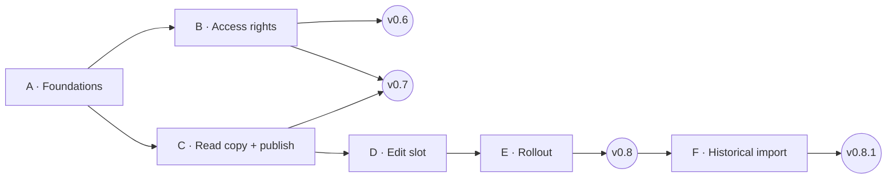

# EPL Tool — Development plan: access rights + multi-user

*Status: decisions recorded · Phases A + B done · v0.6 released as v0.6.1 · updated 6 Nov 2026 · current version v0.6.1*
*Studies: [access-rights-study.md](./access-rights-study.md) · [multi-user-study.md](./multi-user-study.md)*

---

## 1. Overview

The work is split into **6 phases** and delivered in **4 releases**. Each release can be used on its own, so colleagues can be
brought in step by step.

| Release | Phases | What you get | Who can be onboarded | Effort |
|---|---|---|---|---|
| **v0.6 — Governance** | A Foundations + B Access rights | User list, roles, customer pricing modes, *New Customer*, activity log, rules checked in the background process, Help section | Still only you. You set up users, modes and managers and test them with *Preview as…* | 7–8.5 d |
| **v0.7 — Shared reading** | C Read copy + publish | Everybody works on a fresh local copy. An admin edits through *Start editing* / auto-publish, protected by the generation check | **Viewers**, and Users in read-only mode | 3–4 d |
| **v0.8 — Shared editing** | D Edit slot + E Rollout | Edit slot with waiting, take-over, crash recovery and price-list rescue. Update notice, onboarding kit | **Everybody**, within their rights | 4.5–6 d |
| **v0.8.1 — Historical import** | F Import wizard | Upload historical price lists for existing customers and products, from a clear Excel template | — | 2–3 d |
| | | | **Total** | **≈ 16.5–21.5 d** |

**B and C both depend only on A**, so they can be built in parallel. Releasing B first is recommended: access rights must be in
place before anybody else opens the tool.

**Decisions this plan builds on** (details in the two studies):

- **Identity:** Windows account + company email, no password.
- **Roles:** Admin / User / Viewer; unknown users are blocked and can request access.
- **Customers:**
  - one or several managers per customer; managers + admins change master data
  - anyone (Admin/User) can create a customer and becomes its manager
  - existing customers start as *Managed by PBP*; the old "Managed by" text field is dropped
- **Activity log:** visible to everybody.
- **Email templates:** per user.
- **FX rates:** admins set the shared defaults; anybody can use their own rates for the current session.
- **SharePoint permissions:** managed outside the app; the app only reminds admins.
- **Multi-user:** auto-publish about a minute after the last change; take-over after 15 min, release after 30 min; no IT / no Graph
  API; Windows only.
- **Go-live:** the central database may be moved or renamed.

---

## 2. Already done (5 Nov 2026)

- **The old Excel import was removed**:
  - `ipc/migration.ts`, `ImportScreen.tsx`, the `migration:*` channels and their types
  - the Settings card
  - the SheetJS (`xlsx`) dependency and its packaging special case (`forge.config.ts`, `vite.main.config.ts`)

  Checked: type check (only the existing, known errors), lint, Vite build, and packaging into a temporary folder.
- **"Admin Email Addresses" was renamed to "PBP Emails"**: on the Settings card, and as the "PBP" badge/filter and hints on the
  Emails tab and customer page. The `admin_emails` table keeps its name.
- **README and CLAUDE.md** were updated accordingly.

---

## 3. In-app Help (built up across releases)

A **Guides & Help** entry in the sidebar (all roles; above *Change Database*, renamed from "Help" on 6 Nov 2026 so it reads
as documentation and guides), plus "?" links from the relevant controls (Pricing management card, *Start editing*
dialog, FX popover, import wizard). It is written for users; the files in `docs/` stay the design notes.

**How it's built**

- Topics are Markdown files in `src/renderer/help/` and are bundled into the app, so Help works offline and always matches the
  installed version. A small Markdown renderer and a search box over the topics.
- **No duplicated facts:**
  - The permission matrix is **generated from `shared/permissions.ts`**.
  - Timeouts and delays (15 min take-over, 30 min idle release, ~60 s auto-publish, ~45 s slot reservation, 30 s refresh) are
    inserted from the **same constants the code uses**.
  - So Help can't contradict the app.
- **Your access** block at the top: your name, role, the customers you manage, and the admins to contact (with a *Request a
  change* email button).

**Topics by release**

| Release | Topics |
|---|---|
| v0.6 | Getting started & your access · Roles & permissions · Pricing management modes · Creating price lists (single / mass) · Customers & New Customer · Emails tab & PBP emails · Analysis & FX rates (session vs default) · Activity log · Backups · *What's new* |
| v0.7 | Shared database: read mode, *data of …* status, refresh, offline copy, "newer data still syncing", updating the app |
| v0.8 | Editing: *Start editing*, waiting for the slot, auto-publish, **timeouts**, take-over, crash recovery, conflicts and *Re-apply my price lists* · Onboarding a new user (admins, incl. SharePoint permissions) · Rules of use · FAQ / troubleshooting (OneDrive, SmartScreen) |
| v0.8.1 | Historical import: template, validation messages, what is never created |

**Effort:** 0.5 d to build the Help screen, then about 0.25 d of writing per release (included in the phase estimates).

---

## 4. Phases

### Phase A — Foundations (1.5–2 d) — **done 6 Nov 2026**

- [x] **Identity**
  - [x] Add `main/auth.ts`: Windows account from `os.userInfo()`, email from `whoami /upn`, with the OneDrive account email from
        the registry as fallback.
  - [x] Add an `auth:whoami` channel. A development-only environment variable can pretend to be another user
        (`EPL_DEV_ACCOUNT` / `EPL_DEV_EMAIL`, ignored in packaged builds).
- [x] **Schema numbering:** use `PRAGMA user_version` as the schema version (existing level = 6); turn `migrateIfNeeded` into
      numbered steps. A database with a newer schema than the app is refused with *"please update EPL Tool"* (decided 6 Nov;
      Phase C turns this into read-only).
- [x] **Make the database shareable** (multi-user study §5.9):
  - [x] Stop writing `db_path` into the database.
  - [x] Store the logo **inside the database**; export uses ExcelJS `addImage({ base64 })`. Decided 6 Nov: **no fallback to
        the old file path** — an admin selects the logo once in Settings (admin-only from Phase B).
  - [x] Save **email templates per user** in the local `settings.json` (new `prefs:get` / `prefs:set` channels). Decided 6 Nov:
        the old template stored in the database is ignored; the built-in default is used until a user's first send.
  - [x] Also: opening an existing database no longer changes the file (the `units` / `currencies` seeds rewrote
        `sqlite_sequence` on every open), and the generic `settings:get` / `settings:set` channels were removed.
- [x] **Customer update:** `customers:update` accepts only an allow-list of fields.
- [x] **Release menu:** decided 6 Nov: **no menu bar** in releases on Windows (macOS keeps only the app/Edit/Window menus);
      Developer Tools only in development (admin exception added in B).
- [x] ~~Excel import fix~~ — not needed: the old import was removed (§2).

**Done when:**

- [x] an existing database opens with no data change
- [x] sending an email doesn't change the database file (date unchanged)
- [x] the logo appears in exports made from a copy of the database on another PC

Checked on copies of the databases, by running the real main-process code outside the app (no app launch).

### Phase B — Access rights + Help (5.5–6.5 d) → release v0.6 — **done, released as v0.6.1 on 6 Nov 2026**

- [x] **Database:** Migration 7.
  - [x] Add `users`, `customers.pricing_mode` (all → `pbp`), `customer_managers`, `price_lists.created_by_user_id` and
        `audit_log`.
  - [x] Drop `customers.price_list_managed_by` and remove it from types, the customer page and `customers:create`.
  - [x] Make the current Windows user the first admin.
- [x] **`shared/permissions.ts`:** the permission functions used by both sides, plus unit tests (`node:test` via `tsx`, the first
      automated tests in the repo; add `npm test`).
- [x] **A check on every action:** one helper for all channels.
  - [x] Each channel declares its rule; anything not declared is refused.
  - [x] Users who are not on the list can only use `db:*` / `auth:*`.
  - [x] Clear refusal messages.
- [x] **Per-customer checks** in:
  - [x] `price-lists:create` / `price-lists:delete`
  - [x] `customers:update`, hide / restore / permanent delete
  - [x] `emails:set-assignments` / `emails:replace` / `emails:remove` (change only allowed customers, report the skipped ones)
  - [x] new `customers:create` (the creator becomes manager)
  - [x] new `customers:set-access`
- [x] **Activity log:** an `audit()` helper called in the same transaction as every change; `audit:list` with filters.
- [x] **FX rates:**
  - [x] `fx:set` becomes admin-only and saves the **default** rates.
  - [x] The Analysis screen keeps **session rates** in memory only (forgotten when the app closes — decided): start from the
        defaults, *"Your rates (this session)"* label, *Reset to defaults*, and *Save as default rates* for admins.
- [x] **PBP Emails:** admins can add, edit and remove entries. The old import was the only way to fill a new database.
- [x] **Screens:**
  - [x] **Basics:** `AuthContext`, `useCan()`, `LockBadge`, and a route guard that sends unknown users to `/no-access`.
  - [x] **No-access screen:** admin contacts, a *Request access* email, and a short help text.
  - [x] **Sidebar:** name and role.
  - [x] **Settings → Users:**
    - [x] add, edit role, deactivate
    - [x] the last admin can't be removed
    - [x] warning about customers left without an active manager
    - [x] **SharePoint reminder** (Edit for Admin/User, Read for Viewer) and an *Open shared folder* button
    - [x] **Preview as…**
  - [x] **Customers:**
    - [x] Customers list: mode badges and a *My customers* filter.
    - [x] Customer detail: **Pricing management** card (mode + managers) and a **History** section.
    - [x] **New Customer** dialog: SAP ref (required, unique), names, currency, packaging, region, etc.; the creator becomes
          manager; admins choose the mode.
  - [x] **Wizards:**
    - [x] Single wizard Step 1: lists only the user's own customers.
    - [x] Mass update Step 1: other customers are locked, with the reason.
  - [x] **Emails tab:**
    - [x] Edit dialog: only allowed customers can be ticked.
    - [x] Replace / Remove: change only allowed customers, with an *"x of y"* message.
  - [x] **Price lists:**
    - [x] Delete only where allowed.
    - [x] *"Created by"* shown on the price list page.
  - [x] **Read-only for non-admins:** Products, Standard EPL (export stays available), Packaging, Currencies, Units, PBP Emails,
        logo and backup actions.
  - [x] **Settings → Activity:** visible to all, with filters and export to Excel.
- [x] **Help v1** (§3): the screen and the v0.6 topics.
- [x] **Developer Tools:** allowed for admins only in releases.
- [x] **Docs:** README and CLAUDE.md.

**Done when:**

- [x] the permission unit tests pass — `npm test`: 49 tests (every role × mode × action, and the generated matrix against §3.2)
- [x] every row of the permission matrix (access-rights study §3.2) has been checked manually with *Preview as…* for User and
      Viewer — done in the app on 6 Nov 2026 ("all is working well")
- [x] calling a forbidden channel through Developer Tools is refused — every channel goes through the guard; checked by
      calling the real handlers as Admin, User, Viewer, unknown and deactivated people on copies of the database
- [x] every change appears in the activity log
- [x] the matrix shown in Help matches the enforced rules — it is generated from `shared/permissions.ts`

**Implementation notes (6 Nov 2026):**

- Guard: `main/ipc/guard.ts` — every channel is registered with `handle(channel, rule, fn)`, rule `public` / `viewer` /
  `editor` / `admin`; `ipcMain.handle` itself is disabled, so a channel can't exist without a rule. Public channels: `db:*`,
  `auth:*` and the backup recovery channels (`backup:list`, `backup:open-folder`, `backup:restore`).
- Restore from the damaged-database screen is allowed when the current Windows identity is an active admin **in the
  backup** (backups older than the user list are allowed) — decided 6 Nov.
- New customers get PBP copy / PBP common from Settings → PBP Emails (decided 6 Nov). Managers may be active Users or
  Admins (decided 6 Nov).
- Removed unused channels (decided 6 Nov): `customers:delete`, `packaging:update-price`, `export:open-mail-with-attachment`;
  `fx:set` became `fx:set-defaults` (admins, one audited call).
- Checked outside the app on copies of both database files: 105 checks for Phase B (Migration 7, bootstrap, guard, rules,
  preview, emails, audit, restore) and the 52 Phase A checks.
- An independent code review found two issues, both fixed: `price-lists:create` now inserts only the line fields (a crafted
  entry could carry another list's id), and lists of customers that no longer exist (orphans) can be deleted by admins.

### Phase C — Read copy + publish (3–4 d) → release v0.7

**Kickoff — points to confirm with the user before coding** (prepared 6 Nov 2026 from how v0.6.1 is built; the design itself
is in the multi-user study §5, decisions in §8). Ask them in one form, then update this list.

1. **Local mode.** Keep a way to open a `.db` file directly, as today (useful for test databases and development), next to the new
   *Connect to shared database*? Proposal: yes, as *Open a local database (no sharing)* on the setup screen.
2. **Existing installs.** `settings.json` has `lastDbPath` (the database opened directly). Proposal: on first start of v0.7, if
   that file is in a OneDrive/SharePoint-synced folder, offer to connect to it as the shared database; otherwise keep it as a
   local database.
3. **Writes that happen while reading** (they fail under `PRAGMA query_only`):
   - first sign-in of a user added by email only records their Windows account (`currentUser.ts`, `user.link-account`);
   - the first-admin bootstrap (`bootstrapFirstAdmin`) on a database without users;
   - migrations (Migration 8 `sync_meta`, later ones) — by design they run on the local copy only.
   Proposal: in read mode, skip account linking (recognise by email; record the account at the next *Start editing*) and
   allow the bootstrap only in local mode or in edit mode.
4. **Guard + read mode.** Keep the order "role → per-customer rule → read-only". Proposal: add a `writes` flag to the
   `editor`/`admin` channels in `ipc/guard.ts`, so in read mode they are refused with *"Read-only — click Start editing"*
   before the handler runs, instead of relying only on the `SQLITE_READONLY` error.
5. **Startup backup.** Today a backup is written to `EPL-Backups/` (SharePoint) on every open. Phase C: only at *Start editing*
   (and before a restore). Confirm that the local cache gets no backups of its own.
6. **Publish in the activity log.** Should each publish add an entry (`sync.publish`, who/when/generation)? It is written into
   the working copy before the copy is published, so it costs nothing extra. Proposal: yes.
7. **Who edits in v0.7.** The plan says Admins only in v0.7 (Users from v0.8 with the edit slot). Confirm, because Users who
   could create price lists in v0.6.1 lose that until v0.8.
8. **Auto-refresh vs open screens.** Refresh automatically every ~30 s only when no wizard or dialog is open; otherwise show the
   *New data — Refresh* banner. Needs a small "busy" signal from the renderer (wizards, dialogs, unsaved edits).
9. **Paths and names.** Local copies in `%APPDATA%\epl-tool\cache\` and `work\` (study §5.2); manifest file
   `EPL-Database.manifest.json` next to the central DB; `EPL-Conflicts/`. Confirm, or prefer `%LOCALAPPDATA%` for the cache.
10. **Test setup.** Two PCs are needed for the final check (you + a colleague). Before that, extend the main-process checks
    (`epl-tool/scripts/main-checks/`, `npm run test:main`) with a `phase-c.checks.ts` that simulates two PCs as two processes
    with separate `userData` folders sharing a temp "central" folder.

**Starting points in the code:** `main/database.ts` (`openDatabase`, startup backup, `bootstrapFirstAdmin`),
`main/localSettings.ts` (`lastDbPath`), `main/currentUser.ts` (account linking), `main/ipc/guard.ts`, `main/ipc/settings.ts`
(`db:open` / `db:create`), `main/ipc/backup.ts`, `renderer/screens/DatabaseSelector.tsx`, `renderer/components/layout/Sidebar.tsx`
(status line), `renderer/App.tsx` (`AccessGuard`).

- [ ] **SharePoint access in one place:** a `CentralStore` interface and a `SyncedFolderStore` implementation that handles:
  - [ ] download + verify
  - [ ] manifest
  - [ ] publishing with the generation check
  - [ ] spotting OneDrive conflict copies
- [ ] **Generation number:** stored in the database (Migration 8: `sync_meta`).
- [ ] **Read mode:**
  - [ ] Open the local copy with `PRAGMA query_only`; in read mode, "read-only" errors become the message *"Read-only — click
        Start editing"* (the role check runs first).
  - [ ] Check for changes every 30 s; refresh automatically or show a banner.
  - [ ] Offline mode using the last copy.
  - [ ] Block editing when the database needs a newer app version (`minAppVersion` / schema version).
- [ ] **Edit mode, first version (Admins only, no edit slot yet):**
  - [ ] *Start editing* copies the fresh database to a working copy.
  - [ ] Auto-publish about 60 s after the last change; *Finish editing*.
  - [ ] A publish that conflicts with someone else's is refused, and the copy is saved to `EPL-Conflicts/`.
- [ ] **Backups:** one backup at the start of each editing session; none on every open; read-only users never write to
      SharePoint.
- [ ] **Setup and status:** a setup screen *"Connect to shared database"* and a status line in the sidebar.
- [ ] **Help:** the v0.7 topics.

**Done when** (two PCs: you + a colleague):

- the reader sees the admin's changes within about 1–2 minutes
- the reader never changes the central file
- a publish on top of a newer central version is refused and the work is kept
- offline start works from the last copy

### Phase D — Edit slot (3–4 d)

- [ ] **Edit slot:**
  - [ ] a claim file per editing session in `EPL-EditSlot/`
  - [ ] heartbeat every 3 min
  - [ ] about 45 s waiting window; the earliest claim wins
  - [ ] take-over after 15 min without activity
  - [ ] automatic publish and release after 30 min without changes
- [ ] **Waiting:** a waiting dialog, and a Windows notification when the slot is free.
- [ ] ***Start editing* for Users** as well (role check: Admin or User).
- [ ] **Recovery:**
  - [ ] crash recovery (`work\session.json`)
  - [ ] the `EPL-Conflicts/` folder
  - [ ] **"Re-apply my price lists"** rescue tool, with a report of other differences
- [ ] **Help:** the editing topics.

**Done when:** all scenarios in the multi-user study §7 (testing) work on two PCs.

### Phase E — Rollout (1.5–2 d) → release v0.8

- [ ] **Settings → Shared database** card: current editor, last publish, generation, and *Force release* for admins.
- [ ] **Updates:**
  - [ ] An `Installer/` folder on SharePoint with `latest.json`; the app shows an update banner.
  - [ ] The release procedure gains a step: copy the installer to SharePoint.
- [ ] **Help:** onboarding, rules of use, FAQ / troubleshooting. README and CLAUDE.md.
- [ ] **Go-live** (§6) and a pilot with one colleague before everyone else.

### Phase F — Historical price-list import (2–3 d) → release v0.8.1

**Goal:** upload past price lists from Excel for **existing** customers and products. It **never creates or changes** customers,
products, Standard EPL or packaging.

**Who:** Admins, plus Users for the customers they may change (same rule as creating a price list) — decided. It needs the edit
slot.

1. **Template.** *Download template* builds an Excel file from the database (ExcelJS) with:
   - **Instructions**
   - **Price lists:** one row per product line, with the columns *Customer SAP ref · Effective date · Mailing date · Version ·
     Comments · RIP code · Net price · Unit*. Rows with the same customer + effective date + version form one price list.
   - **Customers:** the valid references, names and currencies, limited to the customers the person may import for.
   - **Products:** the valid RIP codes, names and types.
   - Dropdowns (data validation) wherever possible.
2. **Upload and check.** Each row gets a clear message, and these block the row:
   - unknown customer or RIP code (**never created**)
   - a customer the user may not change
   - an invalid date or non-numeric price
   - the same product twice in one list
   - a price list that already exists (same customer + effective date + version, or same ID); these are skipped

   Two things only give a warning: an unknown unit, and a currency that differs from the customer's (the customer's currency is
   used).

   A preview groups the rows by price list (ready / skipped / error, number of lines). The user can download an error report
   (the template plus an *Error* column).
3. **Import.**
   - One transaction per price list, with price type *Net Price*.
   - Product type and name are taken **from the product list**, not the file.
   - The creator is recorded and the activity log gets a `price_list.import` entry.
   - The customer's *latest price list* fields are updated **only if** the imported list is newer by effective date: the same
     "latest" rule as Price Lists, Analysis and delete. Today `price-lists:create` always overwrites them, so importing an old
     list would otherwise replace the real latest one.
4. **Result:** a summary with links to the new price lists and the activity log.

Also: a Help topic, and remember the lessons from the old import (CLAUDE.md, "Old Excel import"): keep spaces in names and convert
Excel dates yourself.

---

## 5. Testing approach

| Level | What | When |
|---|---|---|
| Unit tests | `shared/permissions.ts`: every role × mode × action; import row validation | B, F |
| Preview as… | The permission matrix as seen by a User and a Viewer, without a second Windows account | B |
| Two-PC tests (you + a colleague) | The read / publish / edit-slot scenarios (multi-user study §7) | C, D |
| Regression | Single and mass wizards, exports, email drafts, Standard EPL drafts, backups — as admin | Every release |
| Installer check | Install on a colleague's PC early to catch SmartScreen or AppLocker blocks | Before C |
| Import | The template round trip; files with unknown customers/products, duplicates, wrong dates, other currencies | F |

---

## 6. Go-live checklist (v0.8)

1. Install v0.8 and open the current database (migrations run).
2. In **Settings → Users**, add the other PBP admins and the users (by email), and set customer modes and managers. Check
   everything with *Preview as…*.
3. Create the central folder on SharePoint (e.g. `EPL-Central/`) and **move/rename** the database there, so old app versions can't
   find it.
4. Set SharePoint permissions on that folder (outside the app): **Edit** for Admins and Users, **Read** for Viewers.
5. Put the installer and `latest.json` in `Installer/`.
6. Uninstall old versions and remove old database copies.
7. Onboard colleagues with the checklist in multi-user study §6 (also in Help), starting with one pilot.
8. During the first weeks, watch the **Activity** log and the **Shared database** card.

---

## 7. Risks

| Risk | Mitigation |
|---|---|
| OneDrive on colleagues' PCs is slower or set up differently than expected | Pilot read mode (v0.7) with one colleague before building the edit slot. |
| Corporate policies block the unsigned installer | Test the install on a colleague's PC early; if needed, ask about code signing. |
| Missing a button when locking screens for each role | Rules live only in `shared/permissions.ts`; the matrix is checked screen by screen with *Preview as…*. |
| Few automated tests | Unit tests for permissions and import checks, plus a written manual test script per release. |
| A new database version meets an old app version | Schema version + `minAppVersion` block editing; the update banner points to the installer. |
| Help gets out of date | The matrix and timeouts are generated from code; *What's new* is updated with each release. |

---

## 8. Before starting

All decisions are recorded (the last two on 5 Nov 2026):

- **Historical import:** Admins plus Users, for the customers they may change.
- **Session FX rates:** forgotten when the app closes.

**Next step:** Phase C (read copy + publish) → release v0.7. Phases A and B were released as **v0.6.1** on 6 Nov 2026
(v0.6.0 was not released separately).
