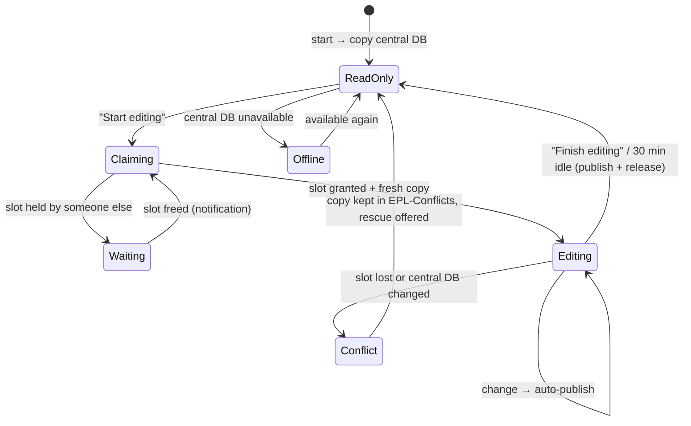
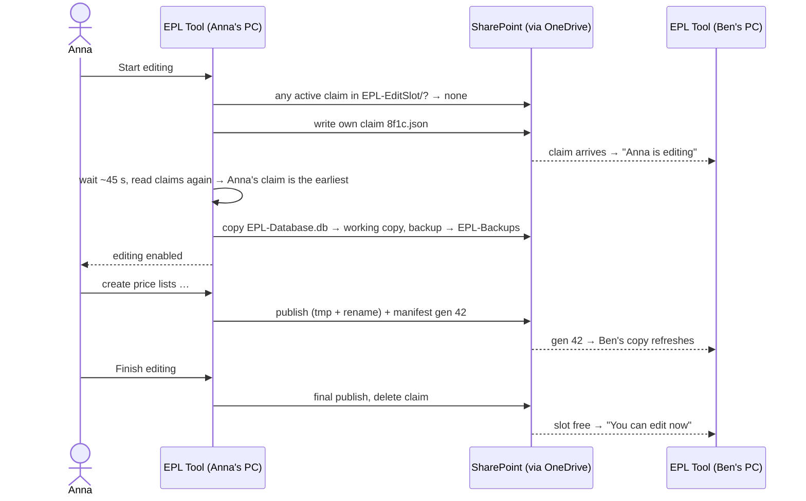

# EPL Tool — Multi-user access study

*Status: approved direction, decisions recorded in §8 · §5.9 done (items 1–3 and 6 on 6 Nov, 4 with Phase B, 5 with Phase C) ·
§5.2–5.8 built in Phase C on 9 Nov 2026 except the edit slot (Phase D) — Phase C decisions and the technical design are in
[dev-plan.md](./dev-plan.md) · based on EPL Tool v0.5.2*
*Related: [access-rights-study.md](./access-rights-study.md) (who may change what) · [dev-plan.md](./dev-plan.md) (combined
development plan, which replaces §7)*

---

## 1. Summary

**Goal.** 1–4 users, each with their own installation of EPL Tool, always see the freshest data, and their changes end up in the
main database, which stays on SharePoint. Real changes happen once or twice a month; reading happens more often.

**Problem.** Today the app opens the SharePoint file directly. That only works for one user. With two users, OneDrive can keep two
diverging copies, and one user's changes end up in a "conflict copy" nobody looks at. Even users who *only read* change the shared
file today (see §3.2).

**Recommendation: read from a local copy, write with an edit slot.**

1. **Read mode is the default.** On start, the app copies the central database from the synced SharePoint folder to the user's PC
   (1–10 MB takes less than a second) and works on that copy. SQLite itself blocks writes in this mode. When someone else publishes
   changes, the app picks them up automatically.
2. **Edit mode needs one click.** The user clicks **Start editing**. The app reserves the single *edit slot* with a small claim file
   next to the database. It then waits about 45 seconds to make sure nobody else claimed the slot at the same moment, downloads the
   freshest database and enables editing. Other users see *"Anna is editing since 10:02"*. They can wait and get a notification when
   the slot is free.
3. **Changes are published to SharePoint automatically.** This happens about a minute after the last change and when the user clicks
   **Finish editing**. The app backs up the database first, then replaces the file in one step (no half-written files).
4. **Nothing is silently overwritten.** Each published version gets a *generation number*. A publish is refused if the central file
   changed since editing started. This could happen if OneDrive was offline or paused. In that case, the user's copy is kept in a
   conflicts folder, and the new price lists in it can be re-applied with one click.

**No general "merge".** With this volume of changes, letting one writer edit at a time is much simpler and safer than merging two
edited databases (see §4, option C). Merging is only used as a rescue step for price lists.

**No IT involvement is needed.** This uses the OneDrive sync client that is already on every machine. A Microsoft Graph API
version (server-side check-out) was considered but is **not pursued**, because it would need IT (decision in §8).

**Effort and order:** see the combined [dev-plan.md](./dev-plan.md) (phases A, C, D, E).

---

## 2. Context and requirements

| Requirement | Implication for the design |
|---|---|
| Main DB stays on SharePoint | SharePoint stores files; it is not a database server. Without IT, the only access is through the **OneDrive sync client**, which syncs whole files. |
| 1–4 users, writes 1–2× per month, reads more often | Allowing **one writer at a time** (a lock) is acceptable. Waiting for the slot with a clear message is acceptable (confirmed). |
| No admin rights, no servers | Per-user installer (Squirrel already installs to `%LocalAppData%`), no background services. |
| Everybody works on fresh data | Copy the database on open, then detect changes and refresh. |
| DB size 1 MB today, ~10 MB later | Copying the whole file is cheap, so incremental sync isn't needed. |
| Windows only (no Mac users — decided) | The design only needs to work with OneDrive on Windows. |

---

## 3. Why the current setup is not multi-user safe

### 3.1 How SharePoint, OneDrive and SQLite interact

- The app never talks to SharePoint directly. Each user's **OneDrive client keeps its own local copy** of the folder and
  uploads or downloads **whole files**. That usually takes seconds, but can take minutes or hours (sync paused, laptop asleep,
  offline, backlog).
- **SQLite locks only work between programs on the same machine.** Across PCs there is no lock: two users can change their own
  copies at the same time.
- If two copies change before they sync, OneDrive normally **keeps both**. One of them is renamed with the computer name, e.g.
  `EPL-Database-LAPTOP-AB12.db`. The app keeps using the other one, so one user's changes seem to disappear.
- Writing to a database inside a synced folder also creates temporary `-journal` files there. The recent change to the rollback
  journal, together with `quick_check` and backups, prevents corruption for **one** writer. It does nothing to coordinate
  **several** writers.

### 3.2 Code that breaks as soon as a second user opens the database (even read-only)

| # | Where | What happens | Impact with several users |
|---|---|---|---|
| 1 | [`db:open`](../epl-tool/src/main/ipc/settings.ts#L46) / [`db:create`](../epl-tool/src/main/ipc/settings.ts#L57) | Writes the user's local absolute path (`db_path`) into `app_settings` on **every open** | Every open by every user changes the shared file, so OneDrive uploads it and can create conflict copies even when nobody edited anything. The stored value is also meaningless to other users. |
| 2 | [`openDatabase`](../epl-tool/src/main/database.ts#L146) | Creates a backup in `EPL-Backups/` on **every open** and keeps only 20 | 4 users opening the app create a constant stream of backups on SharePoint. One user's cleanup deletes backups that others just made, and the backups no longer mean "the state before an edit". |
| 3 | [`SEED_SQL` + `migrateIfNeeded`](../epl-tool/src/main/database.ts#L155) | Schema changes run **directly on the shared file** when the app opens it | Installing a newer app version silently upgrades the shared database, which can break users who still run an older version. Migrations rewrite whole tables inside the synced file. |
| 4 | [`settings:select-logo`](../epl-tool/src/main/ipc/settings.ts#L89), [`buildPriceListXlsx`](../epl-tool/src/main/export/buildPriceListXlsx.ts#L187) | The logo is stored as an **absolute local path** (`C:\Users\<me>\...`) | Other users' Excel exports have no logo, because the path doesn't exist on their PC. |
| 5 | [`EmailComposeDialog`](../epl-tool/src/renderer/components/EmailComposeDialog.tsx#L36) | Saves the subject/body template to the DB on **every Send** | Sending an email, which should only read data, writes to the shared DB. |
| 6 | [`fx:set`](../epl-tool/src/main/ipc/analysis.ts#L56) | Display FX rates on the Analysis screen are saved to the DB | Viewing the analysis can cause a write. |
| 7 | All write handlers in [`src/main/ipc/`](../epl-tool/src/main/ipc) | The app has no idea "who may write right now" | Everybody can change anything at any time. |

---

## 4. Options considered

### A. Everyone opens the shared file directly (today)

Not safe (§3). **Rejected.**

### B. Local copy + one edit slot + publish — **recommended**

Explained in detail in §5.

### C. Local copy + "merge at the end" (your initial idea)

Each user edits a private copy, and the changes are merged into the central database afterwards. There are two ways to do it:

- **C1 – SQLite changesets.** SQLite can record every change made to a copy (the *session extension*) and replay those changes
  on another database, with a callback for conflicts. Our driver, `better-sqlite3`, is **not compiled with this extension**.
  Node's built-in `node:sqlite` has it (`createSession()` / `applyChangeset()`, Node ≥ 23.3, so available in Electron 41), so it
  could be added as a second driver used only for merging.
- **C2 – Merge done by the app.** The app compares the local copy and the central file row by row, using business keys.

Why it doesn't fit:

- **Row ids clash.** Most tables use auto-increment integer ids (`customers.id`, `price_list_entries.id`, `packaging.id`,
  `standard_epl.id`, …). If two users both add rows, they get the same ids, and every insert becomes a conflict. Fixing that means
  re-numbering rows during the merge or changing the schema to use UUIDs.
- **Derived fields clash.** `customers.last_price_list_*` is updated by every price list create and delete. These fields clash even
  when the two users worked on different price lists.
- **Some conflicts need a human decision.** For example, both users change the same customer's emails, both create version 3 for
  the same customer with different prices, or one publishes a Standard EPL draft while the other is still editing it. Each table
  would need its own conflict-resolution screen.
- **A lock is still needed.** Writing the merged result back to the single SharePoint file still needs one exclusive moment.
- **The cost is too high.** It would take weeks, carries a high risk of subtle data errors and is hard to test. That is out of
  proportion for one or two change sessions a month.

**Verdict:** not suitable as the main mechanism. A small version of it is used as a rescue step in option B: re-applying *new
price lists*, which already have a unique text key, `price_list_id`.

### D. SharePoint check-out through the Microsoft Graph API

- The app talks to SharePoint directly over HTTPS, without the OneDrive client:
  - [`POST …/items/{id}/checkout`](https://learn.microsoft.com/graph/api/driveitem-checkout) gives a real, **server-side**
    exclusive lock.
  - The app downloads the file, then uploads the new version with an `If-Match: <eTag>` header. SharePoint answers
    [`412 Precondition Failed`](https://learn.microsoft.com/graph/api/driveitem-update) if someone changed the file in the
    meantime.
  - Finally the app checks the file back in.
- **Pros:**
  - The lock is atomic, with no sync delay and no chance of two simultaneous claims.
  - It doesn't depend on OneDrive running.
  - It works the same on Mac.
  - SharePoint version history gets a check-in comment for each change.
- **Cons:**
  - It needs an **Entra ID app registration** with delegated `Files.ReadWrite(.All)` / `Sites.ReadWrite.All` permissions. Most
    corporate tenants also require admin consent, so this means an **IT request**.
  - The app needs a Microsoft sign-in (MSAL) and has to work through the corporate proxy and SSL inspection.
  - It adds about 3–5 days.
- **Verdict:** technically the best way to talk to SharePoint, but **not pursued (decision: no IT involvement)**. Option B still
  keeps all SharePoint access behind one interface, in case this changes.

### E. A real database server (Azure SQL, Dataverse, SharePoint Lists as storage)

This is proper multi-user storage, but it either breaks the "main DB stays on SharePoint" rule or needs IT. SharePoint Lists would
need Graph plus rewriting every query. **Out of scope.** This fits the deferred "web app" track mentioned in `CLAUDE.md`.

### F. Organisational rule only

One person edits; everyone else gets exports or reads a copy. It costs nothing and can be used **right now as a temporary rule**
(Phase 0), but it doesn't let everyone edit.

### Comparison

| | Data safety | Freshness | User experience | IT needed | Effort | Fits constraints |
|---|---|---|---|---|---|---|
| A. Shared file (today) | ✗ conflict copies | ✓ | simple | no | 0 | ✗ |
| **B. Copy + edit slot** | **✓ never loses data silently** | ✓ up to 1–2 min delay | 1 click to edit; may wait | **no** | **7–11 d** | **✓** |
| C. Copy + merge | ⚠ complex conflicts | ✓ | edit any time, resolve conflicts later | no | weeks | ✓ |
| D. Graph check-out | ✓✓ | ✓✓ no delay | like B + Microsoft sign-in | **yes** (app registration) | B + 3–5 d | ✓ |
| E. DB server | ✓✓ | ✓✓ | best | yes (server) | very high | ✗ |
| F. Rule only | ✓ if followed | ⚠ | limited | no | 0 | partly |

---

## 5. Recommended design: read from a copy, write with an edit slot

### 5.1 Principles

1. **The app never opens the central file with SQLite.** It only *copies* it (to read) and *replaces it in one step* (to publish).
   That means no `-journal` files in SharePoint and no half-written files.
2. **One writer at a time** (the edit slot). Any number of readers.
3. **Every published version has a generation number.** A publish is only allowed on top of the generation the editor started
   from, so nothing is ever silently overwritten.
4. **SQLite itself enforces read-only mode** (`PRAGMA query_only`), not just hidden buttons.
5. **Settings that belong to one PC stay on that PC; shared data lives in the DB.**

### 5.2 Files

**SharePoint folder** (synced by every user):

```
<central folder>/
├── EPL-Database.db              ← main DB; only the slot holder replaces it, always as a whole file
├── EPL-Database.manifest.json   ← last publish: generation, sha256, who, when, schema version, minimum app version
├── EPL-EditSlot/                ← one claim file per edit session: <slotId>.json (only its owner writes it)
├── EPL-Backups/                 ← existing backups: now one per edit session (+ before a restore)
├── EPL-Conflicts/               ← working copies kept when a publish was refused
└── Installer/                   ← EPL-Tool-Setup-x.y.z.exe + latest.json (onboarding and update notice)
```

- Files are first written as `*.tmp` and then renamed. OneDrive [does not sync `.tmp` files](https://support.microsoft.com/en-us/onedrive/restrictions-and-limitations-in-onedrive-and-sharepoint),
  so a half-written file is never uploaded. File names avoid names reserved by OneDrive (`.lock`, `~$…`).
- **One claim file per claimant** instead of a single shared lock file. Nobody ever writes someone else's file, so OneDrive can
  never create conflict copies of the lock itself. Every PC reads the same set of claim files and reaches the same decision (§5.4).

**On each PC** (not synced; decided 9 Nov 2026: the copies in `%LOCALAPPDATA%\epl-tool\`, not roamed with the Windows
profile; `settings.json` stays in `%APPDATA%\epl-tool\`):

```
%APPDATA%\epl-tool\settings.json   ← connection (shared central DB or local file), email templates (per user), UI preferences
%LOCALAPPDATA%\epl-tool\
  cache\EPL-Database.db            ← read-only snapshot of the central DB (+ cache.json: source path, sha256, generation)
  work\EPL-Database.db             ← working copy while editing
  work\session.json                ← base generation + sha256, unpublished-changes flag (crash recovery)
```

**Inside the DB:** a small `sync_meta` table (or `app_settings` keys) holds `generation`, `published_by`, `published_at` and
`published_app_version`. The schema version is stored in `PRAGMA user_version`, which each migration increases.

Claim file example (`EPL-EditSlot/8f1c….json`):

```json
{ "slotId": "8f1c…", "user": "Anna Martin", "account": "J0123456", "machine": "LAPTOP-AB12",
  "claimedAt": "2026-11-05T10:02:11Z", "heartbeatAt": "2026-11-05T10:41:30Z",
  "baseGeneration": 41, "appVersion": "0.6.0" }
```

Manifest example:

```json
{ "generation": 42, "sha256": "…", "publishedBy": "Anna Martin", "publishedAt": "2026-11-05T10:45:02Z",
  "schemaVersion": 7, "minAppVersion": "0.6.0" }
```

### 5.3 App modes



The sidebar shows one status line, for example *"Read-only · data of 5 Nov 10:45 (Anna)"*, *"Editing"*, *"Anna is editing"* or
*"Offline copy"*.

### 5.4 Read mode (default)

On start, on **Refresh**, and whenever a change is detected:

1. **Find the central DB** (path saved in `settings.json`). If OneDrive only has a cloud placeholder, reading the file downloads
   it. We recommend setting the folder to *Always keep on this device*.
2. **Copy it to `cache\incoming.tmp`**, run `quick_check`, and read its generation.
   - If the manifest says a **newer** generation exists, that version hasn't reached this PC yet. The app shows *"Newer data
     published by Anna is still syncing to your computer"*, keeps the current copy and retries every 30 s.
   - If `quick_check` fails (for example, the file was caught mid-sync), the app retries, then keeps the last good copy.
3. **Swap the new copy in and open it.** Migrations run on this **local copy only**, so a newer app can read older data. Then the
   app sets `PRAGMA query_only = ON`.
4. **Check for changes every ~30 s** by looking at the central file's size and date and at the manifest. When something changed,
   the app refreshes automatically if no dialog or wizard is open. Otherwise it shows *"New data published by Anna at 14:05 —
   Refresh"*.
5. **Offline / SharePoint unavailable:** the app opens the last copy with the banner *"Offline copy from 5 Nov 10:45 (read-only)"*.
   Editing is disabled.

### 5.5 Getting the edit slot ("Start editing")



1. **Checks before claiming:**
   - The user's role allows editing: Admin or User. Viewers never claim the slot (see
     [access-rights-study.md](./access-rights-study.md)).
   - The central DB is reachable.
   - The app version is at least `minAppVersion` from the manifest. Otherwise: *"Please install version x.y.z from <Installer
     folder>"*.
   - The user can write to the folder. Otherwise: *"You have read-only access to the shared database."*
2. **Read the active claims.** A claim is active if its heartbeat is less than 15 minutes old.
   - **Someone else holds the slot** → *"Anna Martin (LAPTOP-AB12) has been editing since 10:02 (last activity 10:41). You'll get
     a notification when the slot is free."* [Wait] [Cancel]. While waiting, the app checks every 30 s and shows a Windows
     notification when the slot is free.
   - **Only an expired claim exists** (e.g. the laptop went to sleep) → *"Anna's session has been inactive since 10:41. Take
     over? Any unpublished changes of Anna's will be kept as a conflict copy, not lost."* [Take over] [Wait].
   - **My own claim from before a crash** → resume (§5.7).
3. **Write my own claim** (as `.tmp`, then renamed).
4. **Waiting window** (~45 s, with a progress message: *"Reserving the edit slot — making sure nobody else asked at the same
   moment…"*). OneDrive uploads my claim and downloads any competing one. Then the app reads all active claims again: the
   **earliest `claimedAt` wins** (if two are equal, the smaller `slotId` wins). Every PC sees the same files, so every PC
   reaches the same answer. The loser deletes its own claim and goes to *Wait*.
5. **Make sure the local central file has at least the manifest's generation** (otherwise wait for OneDrive). Then copy it to
   `work\`, verify it, and **back it up to `EPL-Backups/`**. This replaces today's backup on every open.
6. **Open the working copy for editing** and show the banner *"You are editing. Changes are saved on your computer and published
   to SharePoint automatically."* [Finish editing].
7. **Heartbeat:** the app rewrites `heartbeatAt` in my claim file every 3 minutes.

*Why wait about 45 seconds?* Two simultaneous holders are only possible if two people click within the few seconds or minutes it
takes OneDrive to carry a claim to the other PC. The waiting window closes almost all of that gap. The publish check in §5.6
catches what is left, for example a PC whose OneDrive is paused.

### 5.6 Publishing changes

**When:** about 60 s after the last change, on **Finish editing**, when closing the app (with a prompt if publishing fails), and
after a historical price-list import (v0.8.1) or a backup restore.

1. **Do I still hold the slot?** (My claim is still the active winner.) If not → conflict (§5.7).
2. **Is the central DB still at the generation I started from or last published?** (Checked in both the file and the manifest.) If
   not → conflict.
3. In the working copy, add 1 to `generation` and set `published_by`, `published_at` and the app version, in one transaction.
4. Run `VACUUM INTO` to write a clean copy, then copy it to `<central folder>\EPL-Database.db.tmp`, run `quick_check`, and
   **rename it over** `EPL-Database.db`. If OneDrive is holding the file (`EBUSY`), retry.
5. Write the manifest (generation, sha256, …).

**Finish editing** = final publish, then delete my claim, then the working copy becomes the read copy, and the app is back in read
mode. **Idle rule:** after 30 minutes without changes, the app publishes, releases the slot and shows a notification.

Each publish also creates a new version in **SharePoint version history**, a second safety net next to `EPL-Backups`. Because
publishing waits about a minute after the last change, a normal editing session produces only a few versions.

### 5.7 Failures and conflicts

| Situation | How the app notices | What the app does | Data lost? |
|---|---|---|---|
| Two users click *Start editing* within seconds | Waiting window | The earliest claim wins; the other user waits | No |
| One PC's OneDrive is paused or offline when claiming, so it doesn't see Anna's claim | Generation check when publishing (step 2), or OneDrive conflict copy of the DB | Publish refused; working copy saved to `EPL-Conflicts/`; **"Re-apply my new price lists"** offered | No silent loss. Edits other than price lists are listed so they can be redone. |
| The editor's laptop sleeps or the app crashes | Heartbeat older than 15 min | Others can take over after a warning. When the original editor's app wakes up, it sees it lost the slot; if it has unpublished changes, the conflict path applies | No, and auto-publish after ~60 s means there is usually nothing pending |
| App crashes with unpublished changes; my claim is still active | `work\session.json` on next start | *"You have unpublished changes from 10:41."* [Publish now] [Discard] | No |
| Changes were published on the PC, but the laptop shut down before OneDrive uploaded them | Others still see the claim (its deletion wasn't uploaded either), so they wait. If they take over after the timeout, OneDrive later produces a conflict copy of the DB | The app finds `EPL-Database-<PC>.db` in the folder and shows a *Review* banner with the rescue tool | No silent loss |
| Copy downloaded mid-sync or damaged | `quick_check` / sha256 compared with the manifest | Retry; keep the last good copy | No |
| A newer app version published a newer schema | `PRAGMA user_version` / `minAppVersion` | Older apps: read-only with *"Update to version x.y.z to edit"* | No |
| An old (≤ 0.5.x) app opens the central file directly and bypasses all of this | — | **At go-live, rename or move the central DB** so old versions can't find it, and uninstall old versions | Prevented |
| User has only Read permission on SharePoint | The claim can't be written | Read mode only, with a clear message | — |

**Rescue tool ("Re-apply my price lists").** The app opens the conflict copy read-only and lists the price lists whose
`price_list_id` is not in the central DB. After taking the slot, it inserts them through the same code as `price-lists:create`,
including its duplicate check and the update of `customers.last_price_list_*`. Other differences (customers, products, EPL,
packaging, emails) appear in a short report so they can be redone by hand. Given the volumes, this should be very rare.

### 5.8 Enforcing read-only mode in the app

- **Main process:** after opening the read copy, the app runs `PRAGMA query_only = ON`, so any INSERT, UPDATE or DELETE fails with
  `SQLITE_READONLY`. A single wrapper around `ipcMain.handle` turns that error into *"Read-only mode — click Start editing to make
  changes"*. No individual handler has to change.
- **Renderer:** a global `useEditMode()` hook disables or redirects the actions that start a change, so nobody fills in a whole
  wizard and only fails when saving:
  - New Price List and Mass Update
  - Delete buttons
  - Customer, product, packaging, currency and unit editors
  - Standard EPL New Version / Publish
  - Emails bulk edits
  - Historical price-list import
  - Backup restore
  - Other settings changes

  Clicking one of them offers **Start editing**. Reading stays fully available: browsing, Analysis, comparisons, Excel exports and
  email drafts.
- **Migrations** run on the local read copy and on the working copy. They only reach SharePoint through a publish, which requires
  the edit slot.

### 5.9 Making the database shareable (Phase 1 — useful on its own)

Items 1, 2, 3 and 6 were **done in Phase A (6 Nov 2026)**, 4 in Phase B and 5 in Phase C (9 Nov 2026) ([dev-plan.md](./dev-plan.md)).

1. **Stop writing `db_path` into the DB** (in `db:open` and `db:create`). `db:get-path` returns the path known to the main
   process instead. *(Done.)*
2. **Store the logo inside the DB** (base64 data URL in `app_settings.logo_data_url`), so every user's exports show the same
   logo. `buildPriceListXlsx` uses `addImage({ base64 })`. *(Done. Decided 6 Nov: no fallback to the old `logo_path`; an admin
   selects the logo once.)*
3. **Store email templates per user** in the local `settings.json`, so sending an email no longer writes to the DB.
   *(Decided: per user. Done.)*
4. **FX rates on the Analysis screen:** admins set the shared **default** rates, in edit mode. Anybody can change rates for their
   own session; these are not saved, so this causes no database write. *(Decided.)*
5. **Backups:** no backup on every open. Take one at the start of each edit session and before a restore (still keeping 20).
   Readers never write to SharePoint. *(Done in Phase C, 9 Nov 2026; a local database still gets its backup on open.)*
6. **Schema version:** each migration increases `PRAGMA user_version`, so the version can be read without running the migrations.
   *(Done: existing databases are stamped 6; later migrations are numbered steps.)* Opening an up-to-date database no longer
   changes the file at all (the `units` / `currencies` seeds used to rewrite `sqlite_sequence` on every open).

### 5.10 App versions and updates

- With a shared DB, users need compatible versions. The manifest's `minAppVersion` plus the schema version decide who may edit.
- **Distribution:** GitHub Releases already produce the Squirrel `.exe`. Copy it to the `Installer/` folder on SharePoint with a
  `latest.json` file (`{ version, file, notes }`). On start, the app reads `latest.json` and shows *"Version 0.6.1 is available
  — Install"*. Installing needs no admin rights (per-user Squirrel install).
- **Automatic updates:** Electron/Squirrel can update itself from a folder or URL. This is optional and needs testing on corporate
  machines; it isn't needed to start.
- **Code signing:** the installer is unsigned, so Windows SmartScreen shows *"Windows protected your PC"* → *More info → Run
  anyway*. Some machines may block it completely (Defender, AppLocker). Ask IT whether unsigned per-user apps are allowed; a
  signing certificate is the clean fix.

---

## 6. Onboarding a new user

**Admin (once per user)**

1. Add the person in **Settings → Users** (email, display name, role: Admin / User / Viewer) and, for Users, make them manager
   of their customers ([access-rights-study.md](./access-rights-study.md)).
2. Give access to the SharePoint folder:
   - **Edit**, for Admins and Users.
   - **Read**, for Viewers. The app switches to read mode automatically; verify this during testing.
3. Send the user the link to the `Installer/` folder and the checklist below.

**User (about 10 minutes)**

1. Open the SharePoint folder in the browser and click **Sync** (or *Add shortcut to My files*). Wait for OneDrive to show the
   green tick.
2. Right-click the synced folder → **Always keep on this device**.
3. Run `EPL-Tool-Setup-x.y.z.exe` (no admin rights needed). If SmartScreen appears: *More info → Run anyway*.
4. Start EPL Tool → **Connect to shared database** → choose `EPL-Database.db` in the synced folder. The app can suggest it if it
   is in the usual OneDrive location. Check the display name, which is pre-filled from the Windows account.
5. Check that the sidebar shows *"Read-only · data of …"*. Do one **Start editing → Finish editing** cycle together with the admin.
6. Outlook desktop must be set up for email drafts.

**Rules of use** (also shown in the in-app **Help**, see [dev-plan.md](./dev-plan.md) §3)

- The app starts in read-only mode. Click **Start editing** only when you are about to change something, and **Finish editing**
  when you're done. The slot is released automatically after 30 minutes without changes.
- Don't move, rename or copy files in the shared folder, and don't open the DB with other tools.
- Keep OneDrive running and signed in. If the OneDrive icon shows a problem, fix it before editing.
- After editing, wait for *"Published"* before shutting down the PC.

---

## 7. Implementation plan

> **Replaced by the combined [dev-plan.md](./dev-plan.md)** (access rights + multi-user). Mapping: Phase 1 below → Phase A,
> Phase 2 → Phase C, Phase 3 → Phase D, Phase 4 → Phase E. Phase 5 (Graph) is dropped. The dev plan also adds Phase B
> (access rights), the in-app Help and Phase F (historical price-list import). The table is kept for reference; the architecture
> and testing notes below still apply.

| Phase | Content | Main files | Effort |
|---|---|---|---|
| 0 | Temporary rule until Phase 3 is released: one designated editor; other users don't open the central DB with the current version | — | 0 |
| 1 | Make the DB shareable (§5.9) | `ipc/settings.ts`, `ipc/export.ts`, `export/buildPriceListXlsx.ts`, `database.ts`, `backup.ts`, `EmailComposeDialog.tsx` | 1–1.5 d |
| 2 | Read mode: local copy, `query_only`, change detection and refresh, status line, friendly read-only errors, offline mode, "Connect to shared database" setup | `database.ts`, new `main/sync/*`, `ipc/index.ts` (wrapper), `preload/index.ts`, `App.tsx`, `AppShell`/`Sidebar`, `DatabaseSelector.tsx` | 2–3 d |
| 3 | Edit slot, publishing, conflict detection, crash recovery, price-list rescue | new `main/sync/editSlot.ts`, `main/sync/publish.ts`, `ipc/sync.ts`, edit-mode context and dialogs in the renderer | 3–4 d |
| 4 | Disable edit actions in read mode, Settings → "Shared database" card (current editor, last publish, generation, force release), installer folder + update notice, README/onboarding | many screens (small changes) | 1–2 d |
| 5 *(optional)* | Graph API instead of OneDrive (server-side check-out + eTag), if IT approves an app registration | `main/sync/graphStore.ts` | 3–5 d |

**Architecture:** all access to SharePoint goes through one interface, so the OneDrive-based version can later be swapped for
the Graph version.

```ts
interface CentralStore {
  readManifest(): Promise<Manifest | null>;
  download(toLocalPath: string): Promise<DownloadResult>;          // copy + verify
  listClaims(): Promise<SlotClaim[]>;
  writeClaim(claim: SlotClaim): Promise<void>;                     // claim + heartbeat
  deleteClaim(slotId: string): Promise<void>;
  publish(fromLocalPath: string, expectedGeneration: number): Promise<PublishResult>;
  findConflictCopies(): Promise<string[]>;
}
// SyncedFolderStore (phases C–D in dev-plan.md)  ·  GraphStore only if the "no IT" decision changes
```

**Testing:** two PCs (or two Windows accounts) syncing the same SharePoint test folder. Scenarios:

- both users click *Start editing* at the same time
- one edits while the other reads (the reader's refresh appears)
- killing the app while editing
- network unplugged while editing
- OneDrive paused on one PC while both edit
- an older app version against a newer schema
- a user with Read permission only
- the DB file as a cloud-only placeholder
- growing the DB to about 10 MB and timing copy and publish

---

## 8. Decisions (recorded 5 Nov 2026)

| # | Question | Decision |
|---|---|---|
| 1 | Who may edit? | Handled by access rights: Admin / User / Viewer roles plus a pricing mode per customer. See [access-rights-study.md](./access-rights-study.md). SharePoint permissions are an optional outer layer (Edit for Admins and Users, Read for Viewers). |
| 2 | Publishing | Automatic, about 1 minute after the last change, plus *Finish editing* (as recommended). |
| 3 | Timeouts | 15 min without a heartbeat → others can take over; 30 min without changes → the slot is released automatically. |
| 4 | Email templates | **Per user**, stored on the user's PC. This was first "shared", then changed during the access-rights discussion. |
| 5 | FX rates | Shared default rates, set by admins. Anybody can use their own rates for the current session (not saved). |
| 6 | Graph API | No IT involvement, so OneDrive only; option D is not pursued. |
| 7 | macOS | No Mac users; Windows only. |
| 8 | Go-live | Moving or renaming the central database is OK (today there is only one user). |
